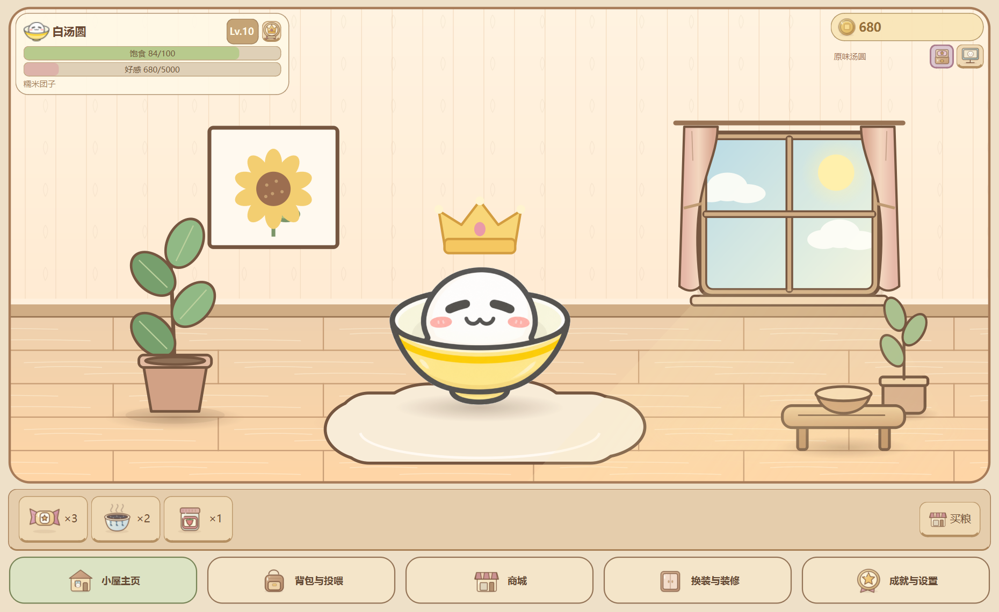
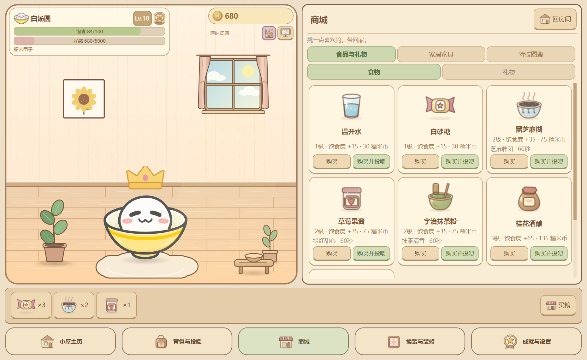
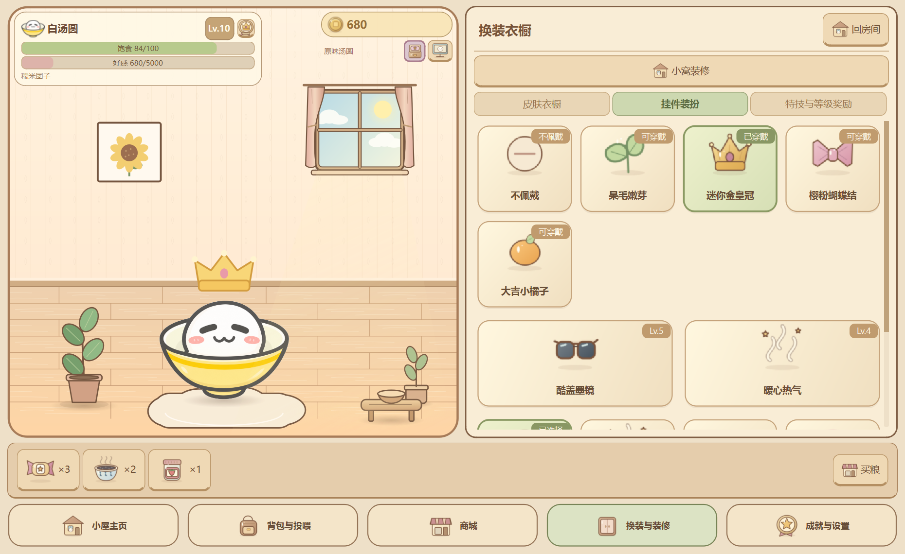

<div align="center">
  
  <h1>Q弹汤圆</h1>
  <p><strong>给桌面留一点软乎乎的陪伴。</strong></p>
  <p>1.0 正式版 · Windows 桌面养成 · 本地存档 · PNG / GIF 自定义皮肤</p>
  <p>
    <a href="docs/使用指南.md">玩家使用指南</a> ·
    <a href="docs/自定义皮肤与便携版.md">自定义皮肤</a> ·
    <a href="docs/开发指南.md">源码运行与构建</a> ·
    <a href="docs/1.0版本说明.md">1.0 版本说明</a>
  </p>
</div>



**Q弹汤圆**是一款以温馨小窝为主界面的桌面宠物养成软件。你可以给它取名字、戳一戳、喂食、送礼、布置房间，也可以让它待在任务栏上陪你工作。饱食度归零只会暂时变成糯米饼，喂一口就能恢复；好感度只增不减。

本仓库以 **v1.0.0** 作为首个对外正式版本，收录目前已经完成的全部功能。历史文档中的“Phase”“V2”是开发阶段名称，现行介绍与操作以本页和玩家指南为准。

## 开始使用

| 你想怎么用 | 入口 |
| --- | --- |
| 已收到 Windows 便携包 | 完整解压 ZIP，双击其中的 `Q弹汤圆.exe`，无需安装 Python；[查看步骤](docs/使用指南.md#启动与退出) |
| 从 GitHub 下载了项目 | 仓库提供的是源码，先按[开发指南](docs/开发指南.md#从源码启动)安装运行环境 |
| 想换成自己的角色 | 在衣橱导入 PNG、GIF 或多状态皮肤包；[查看格式与操作](docs/自定义皮肤与便携版.md) |

**下载说明：** 当前 GitHub 仓库及 1.0 源码发布不附带已编译 Windows 便携包。`Code → Download ZIP` 和 Release 中的 `Source code` 都是源码，解压后没有 EXE。便携包可由作者提供，或按开发指南在 Windows x64 上自行构建。

## 在小窝里，可以做什么

| 体验 | 1.0 已实现的内容 |
| --- | --- |
| 日常陪伴 | 命名、戳戳、摸头；静置后看窗外、溜达、打盹、伸懒腰、哼歌与小跳 |
| 喂养与赠礼 | 7 款食物、4 款礼物；投喂抛物线、咀嚼、粒子、音效和实际收益飘字 |
| 礼物演出 | 陀螺原地横向自转，八音盒摇摆与旋律，花束和折纸星星各有专属反应 |
| 房间装修 | 16 款家具与主题，含坐垫、挂画、茶几食盆、盆栽、灯具及等级装饰 |
| 房间氛围 | 白天流云与阳光、夜晚星空与月光；可开关暖灯，挂钟显示电脑时间 |
| 装扮与特技 | 独立挂件与周身特效；空翻、影分身、弹力球、绕屏和迪斯科 |
| 长期成长 | Lv.1～30 奖励、下一阶段目标预告、12 项成就与可佩戴称号 |
| 自定义衣橱 | PNG / 动态 GIF / 文件夹 / ZIP；预览、真实缩略图、重命名、可还原回收区 |
| 每皮肤配置 | 分别记住角色大小和挂件高度，自定义角色也可使用特技、染色与挂件 |
| 桌面宠物 | 可选的透明置顶悬浮窗；拖拽、倾斜、重力、落地回弹和固定位置记忆 |
| 数据与音效 | 本地自动存档、存档与皮肤 ZIP 备份恢复、静音记忆、单实例唤醒 |

商城、背包、装扮、装修与成就在**主窗口的同屏抽屉**中打开。操作时，旁边的房间和汤圆始终可见。

<table>
  <tr>
    <td></td>
    <td></td>
  </tr>
  <tr>
    <td align="center">商城与背包使用插画格子</td>
    <td align="center">换装、装修即时反映到房间</td>
  </tr>
</table>

## 第一次打开，建议这样玩

1. 点击左上角名字旁的命名按钮，给汤圆起个名字。
2. 在房间里左键戳它，右键摸摸头；暂时不操作，看看它自己的日常。
3. 在商城购买食物并投喂，或将食物带回背包；送礼会增加好感并触发演出。
4. 前往成就页领取首次互动奖励，再尝试买家具、戴挂件和表演特技。
5. 想让它陪你工作时，点击右上角显示桌宠；也可以一直只在小窝里养。
6. 在设置的“数据安全与关于”中备份一次存档，保存属于你的汤圆和皮肤。

详细操作、物品数值、等级路线和常见问题见[玩家使用指南](docs/使用指南.md)。

## 简单认识养成规则

- 初始 **100 糯米币、80 饱食度、Lv.1**。
- 正常在线每 288 秒减少 1 点饱食度，满值降到零需累计在线 8 小时；归零不死亡、不扣好感。
- 食物恢复饱食度，礼物增加好感；每级所需经验为 `当前等级 × 500`。
- 正常在线每 90 秒自动获得 10～20 糯米币与 5 好感经验，无需手动拾取。
- 在线计时只在程序运行时推进，关闭程序期间不补算饥饿、挂机收益或房间日常。

商城消费使用游戏内糯米币，1.0 没有充值或付费购买入口。

## 把喜欢的角色带进小窝

准备一张**透明背景 PNG**或一段**短循环 GIF**，单张素材就能使用呼吸、Q 弹、挂件、特技与风味染色。

衣橱在 Lv.3 免费开放，也可用 50 糯米币提前开启。导入后先预览，确认后才复制进本机衣橱。每张皮肤单独记住 **0.6～1.5 倍大小**和 **-30～30 px 挂件高度**。

进阶用户可制作带 `manifest.json` 的多状态包。素材仅在本机处理与保存，不上传服务器；完整模板见[自定义皮肤指南](docs/自定义皮肤与便携版.md)。

## 源码快速启动

推荐 Windows x64 和 Python 3.12，源码最低要求 Python 3.10。使用便携包的玩家无需执行这些命令。

```powershell
git clone https://github.com/Nozomi-love/q-tangyuan-desktop.git
Set-Location -LiteralPath '.\q-tangyuan-desktop'
python -m venv .venv
.\.venv\Scripts\python.exe -m pip install -r requirements.txt
.\.venv\Scripts\python.exe main.py
```

在独立数据中试用功能：

```powershell
.\.venv\Scripts\python.exe main.py --demo --dev-mode
```

模式区别、测试和打包见[开发指南](docs/开发指南.md)。

## 文档导航

| 文档 | 内容 |
| --- | --- |
| [玩家使用指南](docs/使用指南.md) | 启动退出、养成、商品和等级、存档、排错 |
| [自定义皮肤与便携版](docs/自定义皮肤与便携版.md) | PNG / GIF 建议、模板、导入限制、给朋友使用 |
| [开发指南](docs/开发指南.md) | 环境、参数、测试、架构与打包 |
| [1.0 版本说明](docs/1.0版本说明.md) | 功能范围、版本命名、兼容性与发布状态 |
| [目录说明](docs/目录说明.md) | 九个模块与资源、数据职责 |
| [全部文档与历史记录](docs/README.md) | 项目规范、阶段验收与开发日志 |

## 反馈与素材说明

发现问题可在 [Issues](https://github.com/Nozomi-love/q-tangyuan-desktop/issues) 提供版本、Windows 环境、复现步骤和截图。请先检查截图中的私人信息；个人存档、备份包和导入素材无需公开上传。

默认图片来源见[素材记录](docs/素材记录.md)。第三方依赖的许可文本随 Windows 构建附带；当前仓库没有为项目源码与素材指定统一开源许可证。
