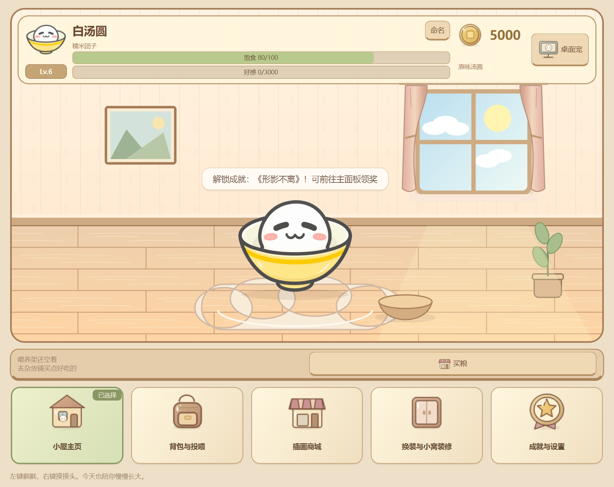
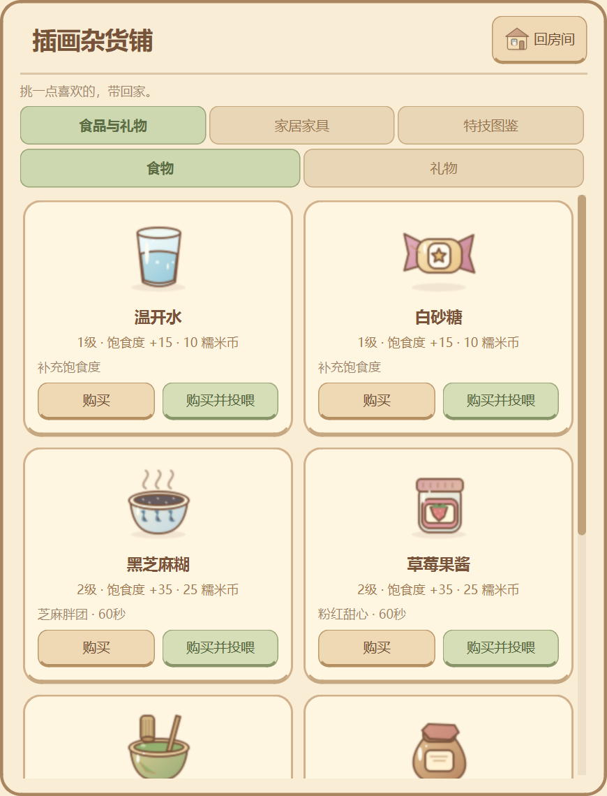

# Q弹汤圆 · 插画游戏小屋

本地离线养成游戏，Python 3.10+、PySide6 6.8.3。启动进入可互动的「汤圆小窝」：命名、喂养、装修、装扮和成就都在家里完成，桌面悬浮宠物可按需显示。现有四图/GIF皮肤、物理动画、风味Buff、三级食物与赠礼、特技和存档完整保留，新增12款家具与第12项成就《温馨小家》。

[GitHub 仓库](https://github.com/Nozomi-love/q-tangyuan-desktop) · [项目规范](docs/项目规范.md) · [开发日志](docs/开发日志.md) · [目录说明](docs/目录说明.md) · [插画游戏界面验收](docs/插画游戏界面验收.md) · [汤圆小窝验收](docs/汤圆小窝验收.md) · [商城与互动更新验收](docs/商城与互动更新验收.md) · [绕屏特技验收](docs/绕屏特技验收.md) · [养成平衡验收](docs/养成平衡更新验收.md) · [Phase 4 记录](docs/Phase4验收.md) · [Phase 3 记录](docs/Phase3验收.md) · [Phase 2 记录](docs/Phase2验收.md) · [素材记录](docs/素材记录.md)

## 双击启动图标（Windows）

本机实际使用的桌面目录为 D:\虚拟C盘，启动图标位于 D:\虚拟C盘\Q弹汤圆.lnk。双击即可直接启动正式模式，无需打开终端。项目内副本为 D:\Codex\Q弹汤圆\Q弹汤圆.lnk，可复制到其他常用文件夹。启动默认打开小窝；双击托盘图标或已显示的桌宠都能唤出主页面。桌面悬浮窗在右上角按钮或托盘菜单切换，选择会存档；退出请使用托盘“退出程序”。

快捷方式使用项目虚拟环境的 pythonw.exe，工作目录和 main.py 参数均指向本项目，图标为 assets/icons/tangyuan.ico。更新项目代码后仍可使用；移动项目目录或重建虚拟环境后需重新配置快捷方式目标。快捷方式包含本机绝对路径，作为本地文件被 Git 忽略；仓库保留通用图标。

窗口、任务栏和托盘现在统一复用同一份tangyuan.ico，并在创建Qt前设置独立Windows应用身份。更新后先退出旧进程再重开；若之前把旧Python入口固定到了任务栏，可取消旧固定后重新固定运行中的汤圆窗口。

如果双击后未出现小窝窗口，可继续使用下方 PowerShell 命令查看启动提示。

## 给朋友使用（免装Python）

已提供Windows x64便携版构建：将releases/中本次生成的ZIP发给朋友，完整解压后双击Q弹汤圆.exe即可，不需要安装Python或PySide6。请保留同文件夹的依赖，不要只发送EXE。

[自定义皮肤格式与便携版说明](docs/自定义皮肤与便携版.md)包含PNG/GIF建议、多状态manifest示例、存档迁移和重新打包命令。

## 运行

先从旧版桌宠的托盘菜单退出，再在 PowerShell 中运行：

    Set-Location -LiteralPath 'D:\Codex\Q弹汤圆'
    .\.venv\Scripts\python.exe main.py

已激活虚拟环境时可以执行 python main.py。新电脑首次安装：

    python -m venv .venv
    .\.venv\Scripts\python.exe -m pip install -r requirements.txt
    .\.venv\Scripts\python.exe main.py

资源相对于 main.py 定位。更新代码后重启旧进程；只更换当前皮肤素材时，可从“调试与外观”重新加载当前皮肤。

独立验收，不影响正式存档：

    .\.venv\Scripts\python.exe main.py --demo

每次 --demo 都新建一个 tests/artifacts/demo-时间/ 存档，并在终端输出位置；演示数据不上传。需要缩短挂机等待时可加 --dev-mode，或在菜单勾选开发测试加速。

## 在汤圆小窝里养宠物

启动后默认显示主窗口，桌面悬浮窗默认隐藏；原有存档中的固定状态和坐标继续保留，显示选择会记住。双击托盘图标打开小窝；主窗口右上角关闭仅收起到托盘，退出程序请用托盘菜单。桌宠双击仍使用200ms判定窗口并取消单击收益。

房间画布至少420px高，汤圆放大显示在坐垫上，带窗帘、暗纹墙纸、木纹地板、窗外昼夜、挂画和绿植。头像、Lv徽章、饱食度/好感条、称号、插画糯米币和桌宠开关浮在房间上方。房内点击汤圆果冻回弹、右键摸头；投喂时插画图标飞入饭碗，状态与桌宠/GIF同步，不重复计时或扣粮。

底部五个80px插画导航为【小屋主页】【背包与投喂】【商城】【换装与小窝装修】【成就与设置】。功能在右侧独立图鉴抽屉打开，不压缩房间；回房间按钮收起。无论之前在哪页，启动或再次召唤主窗都先显示房间。小屏可滚动主场景。

商城分【食品与礼物】【家居家具】【特技图鉴】，食品内再分食物/礼物两个页。图鉴有独立滚动区域和足够高度，解决原先固定矮抽屉导致商品/特技重叠。物品用80px插画+名字+短属性+按钮；装扮与装修全为72～80px可点击图标格，高亮并标「已穿戴/已布置」，没有下拉框或复选框。设置使用插画开关按钮，称号在背包铭牌格切换。

67张本地透明插画位于assets/item_icons/，illustrated_assets.py以QPainter绘制棕色圆润描边、渐变、高光和投影；同名PNG优先读取，缺失才生成，不覆盖本地画师素材。替换后重启，或成就与设置→游戏设置→重新加载外观与图标。文件对应关系见[图标映射](assets/item_icons/README.md)。所有应用文字移除Unicode Emoji，旧存档原始名字/皮肤元数据只在显示层清理，数值和素材不被改写。

12款家具和原有三阶12成就保持，首次购买并布置家具的《温馨小家》奖励60币。

## 分级商城与成就

商城读取 config/catalog.json 的 7 款食物、4 款礼物及永久特技；商城内用【食物】【礼物】两个子标签分别展示三级商品，永久特技位于独立【特技图鉴】页。购买放入背包，或直接购买并投喂 / 赠送；背包使用不再次扣币。**所有食物只恢复饱食度，不增加好感；礼物只增加好感，不恢复饱食度。**

| 食物等级 | 食物 | 价格 | 饱食度 | 风味 |
| --- | --- | --- | --- | --- |
| Ⅰ级 |  温开水、 白砂糖 | 各 10 币 | +15 | 无；白砂糖与右键快捷投喂同源 |
| Ⅱ级 |  黑芝麻糊、 草莓果酱、 宇治抹茶粉 | 各 25 币 | +35 | 灰色与 1.2 倍 / 粉色光点 / 抹茶绿 |
| Ⅲ级 |  桂花酒酿、 变态辣油 | 各 45 币 | +65 | 酒酿无风味；辣油红色与 12 秒小跑，固定时原位跺脚 |

| 礼物等级 | 礼物 | 价格 | 好感 EXP |
| --- | --- | --- | --- |
| Ⅰ级 |  折纸星星 | 20 币 | +20 |
| Ⅱ级 |  小花束 | 70 币 | +80 |
| Ⅲ级 |  八音盒、 陀螺 | 各 180 币 | +240 |

商城【特技图鉴】页可花 **120 糯米币** 学会【 绕屏滚一圈】，购买一次永久拥有，不消耗背包。之后从商城“立即表演”、装扮→特技与等级奖励或右键→表演特技发动。约12秒沿当前屏幕 availableGeometry 四边顺时针滚一圈，再回原位；冷却20秒（从发动计起），不增加EXP。固定开关和位置记忆保持，途中点击可提前回家；换装、工作区变化、切换固定、复位或饿扁也会结束。默认PNG和自定义GIF统一支持皇冠、风味染色与1.2倍。见绕屏特技验收指南。

成功赠送单独累计 stats.total_presents；投喂和在线自动入账仍分别计数。饱食度为 0 时送礼也不能解除饿扁，投喂食物才恢复。礼物不替换当前风味；满级依旧停止积累经验。

风味默认 60 秒，开发加速下新风味 15 秒；同类刷新，不同风味替换，基础食物不清除风味。35% 的 SourceAtop 染色保留 Alpha 与五官，渲染缓存复用染色图；放大、压扁和旋转统一以底部锚点变换，扩大画布预留避免裁切。辣油始终遵守当前位置固定约束。

十二项成就分三阶，可过滤查看、实时显示进度；达成后头顶排队通知，点击领取才发币和称号，奖励只能领取一次。称号在成就页或状态页切换。隐藏彩蛋包括 5 秒 15 次独立戳戳、快速左右摇晃、真实饿扁后喂食恢复；具体阈值与验收清单见 Phase 3 指南。

装扮的三个子页提供皮肤衣橱、独立挂件、程序特技和等级奖励预览；设置页提供固定、复位、加速和饥饿 / 外观调试。新增《灵魂注入》：首次导入/切换自定义皮肤或穿戴挂件，领取 100 币与【百变星君】称号。

继续同一份演示存档时，用终端打印的真实路径：

    .\.venv\Scripts\python.exe main.py --resume-demo 'D:\Codex\Q弹汤圆\tests\artifacts\demo-实际时间\save_data.json'

仅接受 tests/artifacts 中已有的演示文件，不会误指向正式存档。需要继续加速时追加 --dev-mode。

## 养成与快捷互动

右键汤圆或托盘即可查看实时等级 / 经验、饥饿与余额，并购买投喂白砂糖、摸头、固定位置、复位和退出。

| 规则 | 当前数值 |
| --- | --- |
| 初始数值 | 100 币、饥饿 80、Lv.1 / 0 EXP |
| 饥饿衰减 | 正常在线每满 288 秒 -1，100→0 共 28,800 秒（8 小时），最低 0 |
| 零惩罚饿扁 | 真实饥饿 0 时 flat 外观与 40% 高度；不死亡、不扣好感；间隔 45 秒提醒 |
| 戳一戳 | 饥饿 ≥50 时 +2 EXP，否则 +1 EXP；拖拽不计点击 |
| 每日掉币 | 当地自然日的前 20 次点击，各有 35% 概率 +2 币；同时追踪判定次数和掉落次数 |
| 在线收益 | 每 90 秒自动入账 10～20 币及 5 EXP，无需点击，不弹拾币提示 |
| 旧未领金币 | 启动时按原金额自动结算一次，保留原有奖励与统计，不重复领取 |
| 升级 | 当前等级 ×500 EXP 升级（旧版 10 倍），保留余量，每级 +30 币；上限 Lv.30，满级不继续累加经验 |
| 白砂糖 | -10 币，饱食度 +15（最多 100），不加 EXP；成功喂食计入累计投喂 |
| 摸摸头 | +3 EXP、开心反馈、10 秒冷却 |

已有等级和已积累 EXP 按原数值保留，不重置、不按比例缩小；升级进度条以新门槛显示。经验只增不减。挂机统计为累计在线秒数；关闭、休眠或长时间暂停不补算收入与饥饿。正常运行每秒推进模型，养成时钟与动画帧率独立。

气泡是独立无焦点浮窗，支持圆角和淡入淡出，跟随当前表情实际外框并限制在当前工作区；靠近屏幕顶部时移到下方。在线收益与每日戳戳掉币均静默入账，余额/统计实时刷新。头顶主要呈现场景台词，互动优先、重复点击替换当前台词，不堆积相同消息；升级和成就通知仍可排队显示。

| 互动 | 台词示例 |
| --- | --- |
| 戳一戳（含掉币） | 急咯急咯 |
| 已满饱食度时投喂 | 别吃，别吃，饿吗，饿死了吗。 |
| 摸摸头 | 太舒服了！ / 这个摸摸头，可以的。 |
| 拖拽 | 你们是来抓我的吗？ |
| 送陀螺 | 陀螺收到，突然就想转起来了！ |
| 从饿扁恢复 | 这波有救了，我又能弹了！ |

台词集中在 config/catalog.json 的 dialogues，重启后生效。前两句由用户指定；其余短句参考/改写的来源与说明见商城与互动更新验收指南，未将场景改写冒称为直播逐字实录。

升级会开心连跳三次。固定模式保留锚点，用连续 Q 弹反馈庆贺；真实饿扁时保留压扁状态，喂食后恢复。

## 固定位置与存档

勾选“固定当前位置（可拖动调整）”，拖到目标位置松手即可；取消后恢复重力。点击、呼吸和表情仍可使用。复位保留固定开关，移到主屏右下角。

存档位于 data/save_data.json，统一包含养成数据、背包、风味剩余时间、体验过的口味、成就达成 / 领取、称号、每日与累计统计、计时余量、旧未领金币兼容字段、当前皮肤 ID、挂件与偏移、提前导入权限、purchased_tricks永久特技购买记录，owned_furniture / equipped_furniture / placed_furniture家具数据、lamp_on灯光、overlay_visible悬浮窗显隐，以及 window 显示器 / 相对位置 / 固定开关。启动自动读取，互动后短暂合并保存，在线每 15 秒自动保存，安全退出时再保存。

版本 1 / 2 / 3 / 4 存档在首次正常启动时平滑升级到版本 5：先按原字节创建同目录时间戳备份并回读，再保留原窗口设置和未知字段、补充养成默认值。旧“汤圆守护神”称号及佩戴状态自动改为“阿一古”，补充累计赠礼次数。普通运行不会反复补发初始 100 币。损坏、未来版本或无法读取的存档保留原文件，本次仅内存体验并提示；并发写入和过期会话不会覆盖其他进程的较新进度。

存档、导入的 user_* 皮肤、备份、环境和测试产物均不上传 GitHub。测试与 --smoke-test 不使用正式存档。

## 调试

“调试与外观”子菜单提供：饥饿归零、恢复满值、独立手动饿扁、开发计时加速、立即结算在线糯米币和表情热加载。

- 手动测试饿扁不修改真实饥饿；关闭它也不能解除饥饿 0 的真实饿扁。
- 成功喂食会同时结束手动测试，触发恢复回弹；币不足不扣币、不加经验。
- 加速模式：饥饿每 2 秒 -1、在线收益每 10 秒自动入账、饥饿提醒每 8 秒；不用等待或点击领取。
- config/catalog.json 可调整正常 / 加速计时以及各级商品价格、饱食度恢复量、礼物经验（食物经验必须为 0）。重启或切换加速开关重新读取。概率、每日判定上限、升级公式与奖励在 models.py 中维护。
- 调试行为会影响当前存档；建议用 --demo 验收。

## 默认图片与物理

assets/skins/default/expressions.json 将四张用户原始 PNG 映射到 idle / happy / dizzy / flat，也兼容标准状态文件名。优先标准文件；缺图先回退 idle，再使用无五官圆形兜底。默认图片最长边缓存 768；自定义纹理最长边 512，原始图片尺寸和 GIF 解码预算另有限制，见下节。

原图为 1254×1254 的白底 RGB 图片：加载器仅在内存去除边缘连通近白背景，保留轮廓内白色主体；以最大连通主体等比缩放、碗底对齐，保留眩晕图的悬浮星星。原图没有改名或重新编码，散列见素材记录；托盘同步使用待机图。

所有皮肤统一应用底部中心锚点、面积补偿呼吸、阻尼回弹、±18° 拖拽倾角和抛投。目标更新频率 60 Hz，物理子步最多 1/240 秒；长动画停顿最多推进 0.1 秒。工作区使用当前显示器 availableGeometry 和 Qt 逻辑像素；任务栏自动隐藏时遵循系统报告。

## 等级奖励、挂件与通用特技

| 等级 | 自动开放 |
| --- | --- |
| Lv.1 | 白汤圆和基础互动 |
| Lv.2 |  呆毛嫩芽、 原地空翻 |
| Lv.3 |  迷你金皇冠、本地皮肤导入（也可先花 50 币开放导入） |
| Lv.4 |  暖心热气、 Q弹影分身 |
| Lv.5 |  酷盖墨镜、 芝麻弹力球 |
| Lv.6 |  樱粉蝴蝶结、称号【阿一古】 |

好感等级上限仍为 Lv.30，Lv.6 是当前奖励路线末端。装扮 → 挂件装扮可选择头顶挂件、面部挂件、周身特效并调整 -30～+30px 偏移。挂件由 QPainter 独立绘制，以实际主体外框定位，跟随所有形变；不用给每张皮肤重画饰品。

装扮 → 特技与等级奖励中的按钮和右键“ 表演特技”均可启动动作；双击始终打开主面板。空翻 1.1 秒、冷却 5 秒、每次 +5 EXP；影分身 2.5 秒；弹力球 5 秒。特技互斥，拖拽/悬空下落/真实或测试饿扁时暂不启动。固定模式只改变绘制位移，固定坐标保持不动；拖拽或复位可中断表演。

使用 --demo --dev-mode 可在装扮 → 特技与等级奖励勾选“全部等级特权”试用，实际等级和经验不会被提高；试用开关不保存，重启要重新勾选。已选择的皮肤 ID、挂件和偏移会保存，关闭试用后未达到真实等级的挂件暂不绘制。开发试用授予的荣誉称号和实际互动进度仍记入当前演示存档。

## 本地皮肤衣橱与安全限制

装扮 → 皮肤衣橱支持单张 PNG / 动态 GIF、manifest.json 文件夹或 ZIP 动作包，并可导出包含四张示例 PNG 的模板。PNG 可选移除边缘连通纯白背景，原文件不改动。GIF 以 QMovie 当前帧进入统一变换，可戴皇冠、空翻、分身、玩球、染色与 1.2 倍放大。状态缺图回退 idle。GIF 以各帧可见范围并集校准稳定脚底与挂件锚点，透明留白不会抬高宠物或让皇冠悬空。

成功导入只复制素材到 assets/skins/user_<32位ID>/，manifest 最后提交，所选 ID 存入本地版本5存档。重启从沙箱恢复；素材缺失时回退白汤圆并保留原选择。默认四张用户原图不改动；皮肤 ID 不接受外部路径。

- 单文件最多 20MB；ZIP 最多64项、展开总量64MB，只支持 Stored / Deflate 压缩；拒绝加密、异常压缩率、重复大小写、绝对路径、..、反斜杠、设备名、链接和重解析点。只复制配置引用的 PNG/GIF，不执行包内文件。
- 源图最长边 ≤8192、总像素 ≤1600万；GIF 最多200帧、累计逻辑画布像素 ≤6400万。纹理最长边512，QMovie 不缓存全部帧；异常或截断 GIF 会被拒绝。
- 名称与作者按纯文本显示。导出模板只新建带时间戳子目录，不覆盖已有文件。

ℹ 免责声明：本软件为纯本地渲染工具，自定义导入的图片/GIF仅保存在您的电脑本地，不会上传至任何服务器。请确保所导入素材仅供个人学习欣赏或已取得合法授权。

GIF 内存策略依据 Qt 官方 [QMovie 文档](https://doc.qt.io/qt-6.8/qmovie.html) 的缩放和 CacheNone 接口，以及 [QImageReader 文档](https://doc.qt.io/qtforpython-6/PySide6/QtGui/QImageReader.html) 的解码尺寸控制。

## 模块与验证

六个业务文件与两个新增渲染模块的职责见目录说明：main.py 协调应用，models.py 维护养成 / 商城 / 成就 / 特权，pet_engine.py 处理物理 / PNG与GIF / 风味 / 挂件 / 特技，home_scene.py绘制游戏房间，illustrated_assets.py管理67张插画资产，pet_window.py 处理桌面输入与气泡，save_manager.py 处理持久化与皮肤安全导入，dashboard.py 维护小窝HUD、喂养架、五项底部导航与功能抽屉；RoomCanvas矢量房间画布位于pet_engine.py，保持六核心模块。

    .\.venv\Scripts\python.exe -B -X utf8 tests\test_phase5_visual.py
    .\.venv\Scripts\python.exe -B -X utf8 tests\verify_illustrated_native.py
    .\.venv\Scripts\python.exe -B -X utf8 tests\test_phase4_home.py
    .\.venv\Scripts\python.exe -B -X utf8 tests\verify_home_native.py
    .\.venv\Scripts\python.exe -B -X utf8 tests\test_phase1.py
    .\.venv\Scripts\python.exe -B -X utf8 tests\test_phase2.py
    .\.venv\Scripts\python.exe -B -X utf8 tests\test_phase3.py
    .\.venv\Scripts\python.exe -B -X utf8 tests\test_phase4_integration.py
    .\.venv\Scripts\python.exe -B -X utf8 tests\test_phase4_models.py
    .\.venv\Scripts\python.exe -B -X utf8 tests\test_phase4_skins.py
    .\.venv\Scripts\python.exe -B -X utf8 tests\test_phase4_dashboard.py
    .\.venv\Scripts\python.exe -B -X utf8 tests\test_phase4_rendering.py
    .\.venv\Scripts\python.exe -B -X utf8 tests\test_phase4_dialogue.py
    .\.venv\Scripts\python.exe -B -X utf8 tests\verify_shop_dialogue_native.py
    .\.venv\Scripts\python.exe -B -X utf8 tests\test_phase4_screen_roll.py
    .\.venv\Scripts\python.exe -B -X utf8 tests\verify_screen_roll_native.py
    .\.venv\Scripts\python.exe -B -X utf8 tests\test_phase4_balance.py
    .\.venv\Scripts\python.exe -B -X utf8 tests\verify_balance_native.py
    .\.venv\Scripts\python.exe -B -X utf8 tests\verify_phase4_native.py
    .\.venv\Scripts\python.exe -B -X utf8 tests\verify_artwork.py
    .\.venv\Scripts\python.exe -B -X utf8 tests\verify_native.py
    .\.venv\Scripts\python.exe -B -X utf8 tests\verify_pinning.py
    .\.venv\Scripts\python.exe -B -X utf8 tests\verify_phase2_native.py
    .\.venv\Scripts\python.exe -B -X utf8 tests\verify_phase3_native.py
    .\.venv\Scripts\python.exe -B -X utf8 main.py --smoke-test

行为测试可使用 QT_QPA_PLATFORM=offscreen；原生检查在 Windows 打开本程序窗口并自动退出，需在正常桌面会话运行。结果和截图保留在 tests/artifacts/，不递归清理。

本次插画升级的完整验证与验收步骤见[插画游戏界面验收](docs/插画游戏界面验收.md)。前次小窝升级367项及七组原生检查通过，历史验收步骤见[汤圆小窝验收](docs/汤圆小窝验收.md)。历史验证环境：Windows、Python3.12.6、Qt6.8.3、单屏150%缩放。上次商城互动更新完整332项回归通过（已有310项更新新规则+22项专项），26份Python通过3.10语法解析。原生双进程验证两个商城子页、陀螺买入/赠送、真实10秒加速收益自动静默入账、旧未领原金额只结算一次、戳戳掉币不遮台词、满饱投喂/拖拽及重启库存/统计恢复，退出0、stderr空；700/900/1100宽度子标签铺满对齐。Phase2/3/4、绕屏和养成平衡的五组原生双进程复核均通过；正式与--demo --dev-mode冒烟通过。8小时衰减仍用模型推进，多实体屏/其他系统/Python3.10运行未实测。

## 持续版本记录

用户已授权在本项目后续开发任务中自行提交、推送经过验证的进展；每阶段更新 docs/开发日志.md。运行数据不入库；规则见 AGENTS.md。2026-10-18收尾API核验显示仓库当前为公开，本次未修改其可见性。

Qt API 依据：[QTabWidget](https://doc.qt.io/qtforpython-6/PySide6/QtWidgets/QTabWidget.html)、[QPainter](https://doc.qt.io/qtforpython-6/PySide6/QtGui/QPainter.html)、[Signal](https://doc.qt.io/qtforpython-6/PySide6/QtCore/Signal.html)、[QWidget](https://doc.qt.io/qtforpython-6/PySide6/QtWidgets/QWidget.html)、[QTimer](https://doc.qt.io/qtforpython-6/PySide6/QtCore/QTimer.html)。
