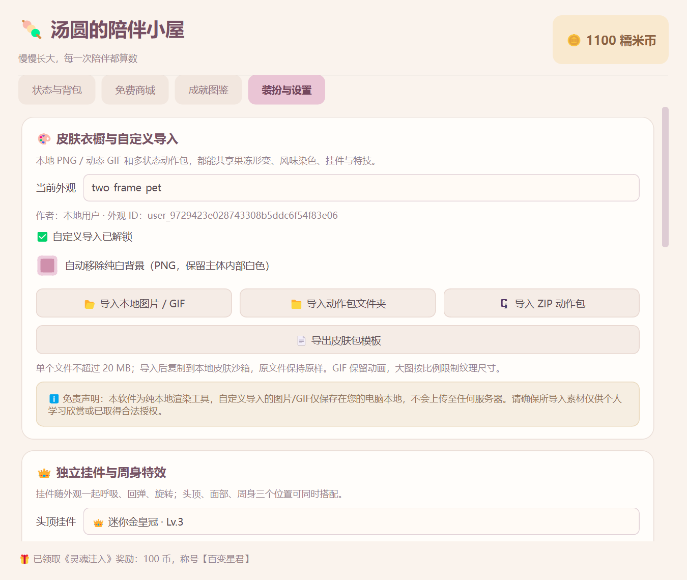
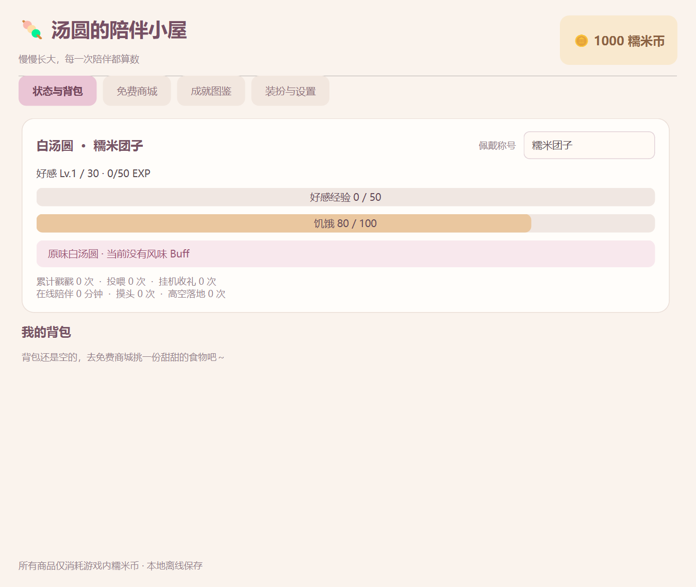
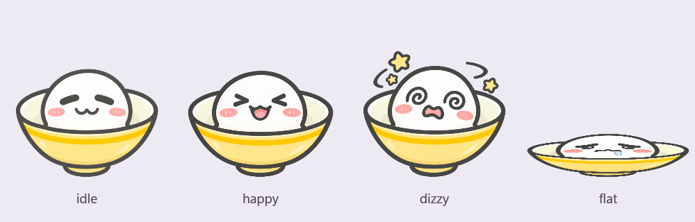

# Q弹汤圆 · Phase 4

本地离线桌宠与免费养成项目，Python 3.10+、PySide6 6.8.3。已完成桌宠物理、四张用户图片适配、固定位置记忆，以及完整养成、四页主面板、七款免费商品 / 背包、限时风味、三阶十一成就、等级奖励、通用挂件/特技与本地 PNG/GIF/动作包衣橱。

[GitHub 私有仓库](https://github.com/Nozomi-love/q-tangyuan-desktop) · [项目规范](docs/项目规范.md) · [开发日志](docs/开发日志.md) · [目录说明](docs/目录说明.md) · [Phase 4 验收指南](docs/Phase4验收.md) · [Phase 3 记录](docs/Phase3验收.md) · [Phase 2 记录](docs/Phase2验收.md) · [素材记录](docs/素材记录.md)

## 双击启动图标（Windows）

本机实际使用的桌面目录为 D:\虚拟C盘，启动图标位于 D:\虚拟C盘\Q弹汤圆.lnk。双击即可直接启动正式模式，无需打开终端。项目内副本为 D:\Codex\Q弹汤圆\Q弹汤圆.lnk，可复制到其他常用文件夹。桌宠已运行时，双击桌宠或从托盘打开主面板；退出请使用托盘“退出程序”。

快捷方式使用项目虚拟环境的 pythonw.exe，工作目录和 main.py 参数均指向本项目，图标为 assets/icons/tangyuan.ico。更新项目代码后仍可使用；移动项目目录或重建虚拟环境后需重新配置快捷方式目标。快捷方式包含本机绝对路径，作为本地文件被 Git 忽略；仓库保留通用图标。

如果双击后未出现桌宠，可继续使用下方 PowerShell 命令查看启动提示。

## 运行

先从旧版桌宠的托盘菜单退出，再在 PowerShell 中运行：

    Set-Location -LiteralPath 'D:\Codex\Q弹汤圆'
    .\.venv\Scripts\python.exe main.py

已激活虚拟环境时可以执行 python main.py。新电脑首次安装：

    python -m venv .venv
    .\.venv\Scripts\python.exe -m pip install -r requirements.txt
    .\.venv\Scripts\python.exe main.py

资源相对于 main.py 定位。更新代码后重启旧进程；只更换当前皮肤素材时，可从“调试与外观”重新加载当前皮肤。

独立验收，不影响正式存档：

    .\.venv\Scripts\python.exe main.py --demo

每次 --demo 都新建一个 tests/artifacts/demo-时间/ 存档，并在终端输出位置；演示数据不上传。需要缩短挂机等待时可加 --dev-mode，或在菜单勾选开发测试加速。

## 四页主面板、免费商城与成就

双击桌宠或点菜单“打开主面板”即可唤出养成小屋；右上角关闭只隐藏，托盘“退出程序”安全保存并结束。双击使用 200ms 判定窗口，取消两次点击收益；单击稍延迟确认，拖拽不计点击。

四页包括：状态与背包、免费商城、成就图鉴、装扮与设置。状态实时显示称号、经验 / 饥饿、余额、Buff 倒计时和累计统计。商城读取 config/catalog.json 的七款食物，支持买进背包或购买并投喂；背包使用不再扣币，余额不足时禁用购买。

| 食物 | 币 | 饥饿 / EXP | 风味 |
| --- | --- | --- | --- |
| 💧 温开水 | 5 | +10 / +5 | 基础食物 |
| 🍬 白砂糖 | 10 | +25 / +10 | 与右键快捷投喂同源 |
| 🍶 桂花酒酿 | 25 | +50 / +25 | 基础食物 |
| 🥣 黑芝麻糊 | 35 | +40 / +20 | 灰色 +1.2 倍体型 |
| 🍓 草莓果酱 | 35 | +40 / +20 | 粉色 + 上升光点 |
| 🍵 宇治抹茶粉 | 35 | +40 / +20 | 抹茶绿 |
| 🌶️ 变态辣油 | 45 | +30 / +35 | 红色；前 12 秒小跑轻跳，固定时原位跺脚 |

风味默认 60 秒，开发加速下新风味 15 秒；同类刷新，不同风味替换，基础食物不清除风味。35% 的 SourceAtop 染色保留 Alpha 与五官，渲染缓存复用染色图；放大、压扁和旋转统一以底部锚点变换，扩大画布预留避免裁切。辣油始终遵守当前位置固定约束。

十一项成就分三阶，可过滤查看、实时显示进度；达成后头顶排队通知，点击领取才发币和称号，奖励只能领取一次。称号在成就页或状态页切换。隐藏彩蛋包括 5 秒 15 次独立戳戳、快速左右摇晃、真实饿扁后喂食恢复；具体阈值与验收清单见 Phase 3 指南。

设置页提供皮肤衣橱、独立挂件、程序特技、等级奖励预览，以及固定、复位、加速和饥饿 / 外观调试。新增《灵魂注入》：首次导入/切换自定义皮肤或穿戴挂件，领取 100 币与【百变星君】称号。

继续同一份演示存档时，用终端打印的真实路径：

    .\.venv\Scripts\python.exe main.py --resume-demo 'D:\Codex\Q弹汤圆\tests\artifacts\demo-实际时间\save_data.json'

仅接受 tests/artifacts 中已有的演示文件，不会误指向正式存档。需要继续加速时追加 --dev-mode。

## 养成与快捷互动

右键汤圆或托盘即可查看实时等级 / 经验、饥饿与余额，并购买投喂白砂糖、摸头、固定位置、复位和退出。

| 规则 | 当前数值 |
| --- | --- |
| 初始数值 | 100 币、饥饿 80、Lv.1 / 0 EXP |
| 饥饿衰减 | 在线每满 180 秒 -1，最低 0 |
| 零惩罚饿扁 | 真实饥饿 0 时 flat 外观与 40% 高度；不死亡、不扣好感；间隔 45 秒提醒 |
| 戳一戳 | 饥饿 ≥50 时 +2 EXP，否则 +1 EXP；拖拽不计点击 |
| 每日掉币 | 当地自然日的前 20 次点击，各有 35% 概率 +2 币；同时追踪判定次数和掉落次数 |
| 挂机拾币 | 每 90 秒出现一个 10～20 币礼包；点气泡或汤圆领取，另加 5 EXP |
| 礼包超时 | 30 秒后自动入账；未领取金额与剩余时间可跨重启恢复，不能重复领取 |
| 升级 | 当前等级 ×50 EXP 升级，保留余量，每级 +30 币；上限 Lv.30，满级不继续累加经验 |
| 白砂糖 | -10 币，饥饿 +25（最多 100），+10 EXP；成功喂食计入累计投喂 |
| 摸摸头 | +3 EXP、开心反馈、10 秒冷却 |

经验只增不减。挂机统计为累计在线秒数；关闭、休眠或长时间暂停不补算收入与饥饿。正常运行每秒推进模型，养成时钟与动画帧率独立。

气泡是独立无焦点浮窗，支持圆角、淡入淡出、礼包微光与浮动。跟随当前表情的实际外框，在当前屏幕工作区内限制位置；靠近屏幕顶部时移到下方。升级消息优先显示，结束后仍可继续显示待领礼包。

升级会开心连跳三次。固定模式保留锚点，用连续 Q 弹反馈庆贺；真实饿扁时保留压扁状态，喂食后恢复。

## 固定位置与存档

勾选“固定当前位置（可拖动调整）”，拖到目标位置松手即可；取消后恢复重力。点击、呼吸和表情仍可使用。复位保留固定开关，移到主屏右下角。

存档位于 data/save_data.json，统一包含养成数据、背包、风味剩余时间、体验过的口味、成就达成 / 领取、称号、每日与累计统计、计时余量、未领礼包、当前皮肤 ID、挂件与偏移、提前导入权限，以及 window 显示器 / 相对位置 / 固定开关。启动自动读取，互动后短暂合并保存，在线每 15 秒自动保存，安全退出时再保存。

Phase 1～3 的版本 1 / 2 / 3 存档在首次正常启动时平滑升级到版本 4：先按原字节创建同目录时间戳备份并回读，再保留原窗口设置和未知字段、补充养成默认值。普通运行不会反复补发初始 100 币。损坏、未来版本或无法读取的存档保留原文件，本次仅内存体验并提示；并发写入和过期会话不会覆盖其他进程的较新进度。

存档、导入的 user_* 皮肤、备份、环境和测试产物均不上传 GitHub。测试与 --smoke-test 不使用正式存档。

## 调试

“调试与外观”子菜单提供：饥饿归零、恢复满值、独立手动饿扁、开发计时加速、立即生成礼包和表情热加载。

- 手动测试饿扁不修改真实饥饿；关闭它也不能解除饥饿 0 的真实饿扁。
- 成功喂食会同时结束手动测试，触发恢复回弹；币不足不扣币、不加经验。
- 加速模式：饥饿每 2 秒 -1、礼包每 10 秒、饥饿提醒每 8 秒。礼包仍有 30 秒领取时间，未领礼包不会叠加。
- config/catalog.json 可调整正常 / 加速计时以及白砂糖价格、恢复量、经验。重启或切换加速开关重新读取。概率、每日判定上限、升级公式与奖励在 models.py 中维护。
- 调试行为会影响当前存档；建议用 --demo 验收。

## 默认图片与物理

assets/skins/default/expressions.json 将四张用户原始 PNG 映射到 idle / happy / dizzy / flat，也兼容标准状态文件名。优先标准文件；缺图先回退 idle，再使用无五官圆形兜底。默认图片最长边缓存 768；自定义纹理最长边 512，原始图片尺寸和 GIF 解码预算另有限制，见下节。

原图为 1254×1254 的白底 RGB 图片：加载器仅在内存去除边缘连通近白背景，保留轮廓内白色主体；以最大连通主体等比缩放、碗底对齐，保留眩晕图的悬浮星星。原图没有改名或重新编码，散列见素材记录；托盘同步使用待机图。

所有皮肤统一应用底部中心锚点、面积补偿呼吸、阻尼回弹、±18° 拖拽倾角和抛投。目标更新频率 60 Hz，物理子步最多 1/240 秒；长动画停顿最多推进 0.1 秒。工作区使用当前显示器 availableGeometry 和 Qt 逻辑像素；任务栏自动隐藏时遵循系统报告。

## 等级奖励、挂件与通用特技

| 等级 | 自动开放 |
| --- | --- |
| Lv.1 | 白汤圆和基础互动 |
| Lv.2 | 🌱 呆毛嫩芽、🌀 原地空翻 |
| Lv.3 | 👑 迷你金皇冠、本地皮肤导入（也可先花 50 币开放导入） |
| Lv.4 | ♨️ 暖心热气、✨ Q弹影分身 |
| Lv.5 | 🕶️ 酷盖墨镜、⚽ 芝麻弹力球 |
| Lv.6 | 🎀 樱粉蝴蝶结、称号【✨ 汤圆守护神】 |

好感等级上限仍为 Lv.30，Lv.6 是当前奖励路线末端。Tab4 可选择头顶挂件、面部挂件、周身特效并调整 -30～+30px 偏移。挂件由 QPainter 独立绘制，以实际主体外框定位，跟随所有形变；不用给每张皮肤重画饰品。

Tab4 按钮和右键“🎪 表演特技”均可启动动作；双击始终打开主面板。空翻 1.1 秒、冷却 5 秒、每次 +5 EXP；影分身 2.5 秒；弹力球 5 秒。特技互斥，拖拽/悬空下落/真实或测试饿扁时暂不启动。固定模式只改变绘制位移，固定坐标保持不动；拖拽或复位可中断表演。

使用 --demo --dev-mode 可在 Tab4 勾选“全部等级特权”试用，实际等级和经验不会被提高；试用开关不保存，重启要重新勾选。已选择的皮肤 ID、挂件和偏移会保存，关闭试用后未达到真实等级的挂件暂不绘制。开发试用授予的荣誉称号和实际互动进度仍记入当前演示存档。

## 本地皮肤衣橱与安全限制

Tab4 支持单张 PNG / 动态 GIF、manifest.json 文件夹或 ZIP 动作包，并可导出包含四张示例 PNG 的模板。PNG 可选移除边缘连通纯白背景，原文件不改动。GIF 以 QMovie 当前帧进入统一变换，可戴皇冠、空翻、分身、玩球、染色与 1.2 倍放大。状态缺图回退 idle。GIF 以各帧可见范围并集校准稳定脚底与挂件锚点，透明留白不会抬高宠物或让皇冠悬空。

成功导入只复制素材到 assets/skins/user_<32位ID>/，manifest 最后提交，所选 ID 存入本地版本4存档。重启从沙箱恢复；素材缺失时回退白汤圆并保留原选择。默认四张用户原图不改动；皮肤 ID 不接受外部路径。

- 单文件最多 20MB；ZIP 最多64项、展开总量64MB，只支持 Stored / Deflate 压缩；拒绝加密、异常压缩率、重复大小写、绝对路径、..、反斜杠、设备名、链接和重解析点。只复制配置引用的 PNG/GIF，不执行包内文件。
- 源图最长边 ≤8192、总像素 ≤1600万；GIF 最多200帧、累计逻辑画布像素 ≤6400万。纹理最长边512，QMovie 不缓存全部帧；异常或截断 GIF 会被拒绝。
- 名称与作者按纯文本显示。导出模板只新建带时间戳子目录，不覆盖已有文件。

ℹ️ 免责声明：本软件为纯本地渲染工具，自定义导入的图片/GIF仅保存在您的电脑本地，不会上传至任何服务器。请确保所导入素材仅供个人学习欣赏或已取得合法授权。

GIF 内存策略依据 Qt 官方 [QMovie 文档](https://doc.qt.io/qt-6.8/qmovie.html) 的缩放和 CacheNone 接口，以及 [QImageReader 文档](https://doc.qt.io/qtforpython-6/PySide6/QtGui/QImageReader.html) 的解码尺寸控制。

## 模块与验证

六个核心 Python 文件的职责见目录说明：main.py 协调应用，models.py 维护养成 / 商城 / 成就 / 特权，pet_engine.py 处理物理 / PNG与GIF / 风味 / 挂件 / 特技，pet_window.py 处理桌面输入与气泡，save_manager.py 处理持久化与皮肤安全导入，dashboard.py 维护四页界面。

    .\.venv\Scripts\python.exe -B -X utf8 tests\test_phase1.py
    .\.venv\Scripts\python.exe -B -X utf8 tests\test_phase2.py
    .\.venv\Scripts\python.exe -B -X utf8 tests\test_phase3.py
    .\.venv\Scripts\python.exe -B -X utf8 tests\test_phase4_integration.py
    .\.venv\Scripts\python.exe -B -X utf8 tests\test_phase4_models.py
    .\.venv\Scripts\python.exe -B -X utf8 tests\test_phase4_skins.py
    .\.venv\Scripts\python.exe -B -X utf8 tests\test_phase4_dashboard.py
    .\.venv\Scripts\python.exe -B -X utf8 tests\test_phase4_rendering.py
    .\.venv\Scripts\python.exe -B -X utf8 tests\verify_phase4_native.py
    .\.venv\Scripts\python.exe -B -X utf8 tests\verify_artwork.py
    .\.venv\Scripts\python.exe -B -X utf8 tests\verify_native.py
    .\.venv\Scripts\python.exe -B -X utf8 tests\verify_pinning.py
    .\.venv\Scripts\python.exe -B -X utf8 tests\verify_phase2_native.py
    .\.venv\Scripts\python.exe -B -X utf8 tests\verify_phase3_native.py
    .\.venv\Scripts\python.exe -B -X utf8 main.py --smoke-test

行为测试可使用 QT_QPA_PLATFORM=offscreen；原生检查在 Windows 打开本程序窗口并自动退出，需在正常桌面会话运行。结果和截图保留在 tests/artifacts/，不递归清理。

验证环境：Windows、Python 3.12.6、Qt 6.8.3、单屏 150% 缩放。51 + 44 + 48 项旧回归和 119 项 Phase 4 新增测试，共 262 项全部通过；20份Python文件通过3.10语法解析。实际GIF、皇冠、三特技及两个独立进程恢复验证通过，普通与 --demo --dev-mode 冒烟均退出0、stderr空（两秒各120次更新，测试关闭正式存档读写）。原生养成检查使用真实的加速计时；90 秒正式阈值和 30 秒超时采用模型推进验证。负坐标屏幕边界采用模拟，多块物理显示器、其他系统及 Python 3.10 未实测。

## 持续版本记录

用户已授权在本项目后续开发任务中自行提交、推送经过验证的进展；每阶段更新 docs/开发日志.md。GitHub 保持私有，运行数据不入库；规则见 AGENTS.md。

Qt API 依据：[QTabWidget](https://doc.qt.io/qtforpython-6/PySide6/QtWidgets/QTabWidget.html)、[QPainter](https://doc.qt.io/qtforpython-6/PySide6/QtGui/QPainter.html)、[Signal](https://doc.qt.io/qtforpython-6/PySide6/QtCore/Signal.html)、[QWidget](https://doc.qt.io/qtforpython-6/PySide6/QtWidgets/QWidget.html)、[QTimer](https://doc.qt.io/qtforpython-6/PySide6/QtCore/QTimer.html)。
