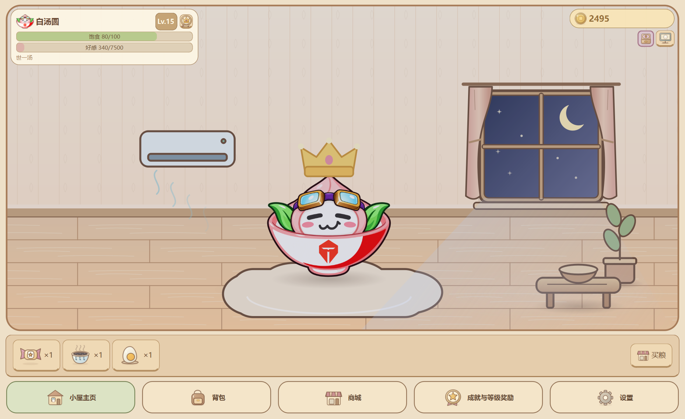
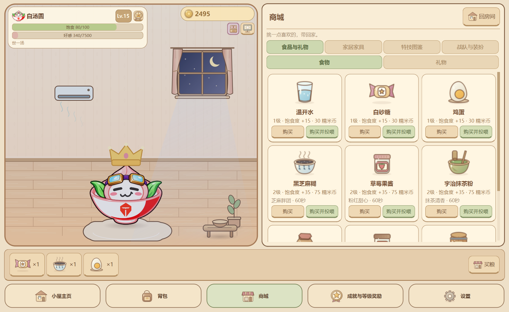
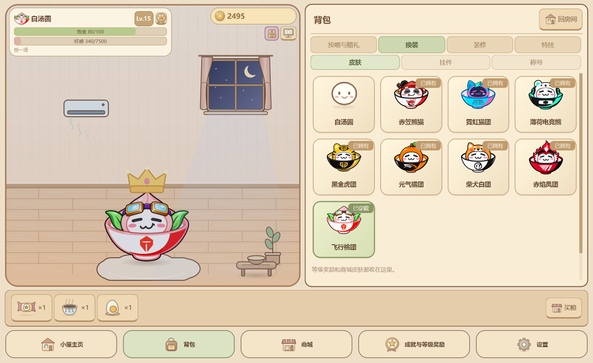

<div align="center">
  
  <h1>Q弹汤圆 2.0</h1>
  <p><strong>把赛场外的梗，装进一碗汤圆里。</strong></p>
  <p>英雄联盟赛事社区同人 · Windows 本地游戏 · 房间与可选桌宠</p>
  <p>
    <a href="docs/使用指南.md">使用说明</a> ·
    <a href="docs/2.0版本说明.md">2.0 更新内容</a> ·
    <a href="docs/开发指南.md">源码运行与构建</a> ·
    <a href="https://github.com/Nozomi-love/q-tangyuan-desktop/releases/tag/v2.0.0">版本发布</a>
  </p>
</div>



**Q弹汤圆**是一款围绕英雄联盟职业比赛、选手和社区二创文化制作的本地互动软件。灵感来自炫神传播的汤圆表情、TES陀螺等共同记忆：养成、小窝和桌宠是玩法载体，熟悉的台词、道具和应援皮肤才是它的个性。

你可以戳它听一句“急咯急咯”，送陀螺让它原地快速横向自转，换上飞行桃团再送吉他、麦克风；也能布置空调、展开凤凰翅膀，收集“世一汤”“金汤良圆”等称号。柔和的房间外观与圈内语境并存，软件运行不依赖联网。

## 下载与启动

**当前 2.0 发布提供源码与正式项目素材，没有附 Windows EXE。** GitHub 的 `Code → Download ZIP` 和 Release 的 `Source code` 均需 Python 环境；它们不是免安装包。

| 你拿到的文件 | 怎么使用 |
| --- | --- |
| GitHub 源码 | 按下方命令安装环境，或查看[开发指南](docs/开发指南.md) |
| 作者另行提供的完整便携 ZIP | 完整解压后双击 `Q弹汤圆.exe`，无需 Python；不要只复制 EXE |
| 旧版本程序 | 先从托盘退出，再打开新版；建议先备份进度 |

Windows x64、Python 3.10+；推荐 Python 3.12。

```powershell
git clone https://github.com/Nozomi-love/q-tangyuan-desktop.git
Set-Location -LiteralPath '.\q-tangyuan-desktop'
python -m venv .venv
.\.venv\Scripts\python.exe -m pip install -r requirements.txt
.\.venv\Scripts\python.exe main.py
```

**2026-10-24 main 源码更新**：包含首批16件道具、旧装扮精简、沉浸式房间与 Part 1/2 扩充。产品版本仍为2.0.0，既有 v2.0.0 标签保留原发布快照；获取最新代码请下载 main 分支。本次没有重建或附加 EXE。

房间已改为铺满窗口的2.5D绘本空间，加入透视木地板、厚窗台、书柜、前景案几与悬浮徽章；同屏抽屉保留。见[沉浸房间验收指南](docs/立体绘本房间验收.md)。

## 2.0 可以玩什么

| 内容 | 已实现 |
| --- | --- |
| 队标皮肤 | 八款内置应援汤圆，等级解锁或900币提前永久购买，名字只显示外观昵称 |
| 赛事道具 | 空调、鸡蛋、酒桶、凤凰翅膀、飞行桃团专属吉他与麦克风 |
| 互动演出 | 陀螺横向自转、八音盒、练习册、沙漏、击拳及其余礼物的独立演出 |
| 完整养成 | 饱食、Lv.1～30、在线币、12项成就、称号与长期等级奖励 |
| 物品收集 | 15款食物、13款礼物、23款家具与主题、116张物品与导航插画 |
| 房间与桌面 | 同屏抽屉、昼夜光影、日常溜达与打盹；可隐藏、可固定的透明桌宠 |
| 通用装扮 | 挂件、翅膀、周身特效；空翻、分身、弹力球、绕屏、迪斯科、反向闪现；头/脸/背/周身四槽换装 |
| 本地体验 | 自动存档、备份恢复、静音记忆、单实例唤醒、独立演示档 |

### 八款应援皮肤


| 赛区 | 对应队伍 | 外观昵称 | 免费解锁 |
| --- | --- | --- | --- |
| LPL | AL | 赤笠熊猫 | Lv.2 |
| LPL | BLG | 霓虹猫团 | Lv.3 |
| LPL | TES | 飞行桃团 | Lv.4 |
| LPL | iG | 柴犬白团 | Lv.5 |
| LCK | GEN | 黑金虎团 | Lv.6 |
| LCK | HLE | 元气橘团 | Lv.8 |
| LCK | T1 | 赤焰凤团 | Lv.10 |
| LCK | DK | 薄荷电竞熊 | Lv.15 |

每款也可在 **商城 → 战队与装扮** 提前购买，不重复收费。碗面使用队徽，皮肤卡片不加战队名前缀。当前每款是一张透明基础图，表情状态回退到该图，呼吸、回弹、染色和挂件继续生效。见[正式素材说明](assets/skins/teams_s16/README.md)。

## 所有东西，统一收进背包

底部为 **小屋主页 / 背包 / 商城 / 成就与等级奖励 / 设置**。功能抽屉在房间旁展开，换装、装修、投喂时始终能看到汤圆。

| 入口 | 里面有什么 |
| --- | --- |
| 背包 | 投喂与赠礼；换装下的皮肤、挂件、称号；装修；特技 |
| 商城 | 食品与礼物（分子页）、家居家具、特技图鉴、战队与装扮 |
| 成就与等级奖励 | 成就达成与领奖、等级路线与下一阶段目标 |
| 设置 | 桌宠开关、位置、静音、数据目录与备份恢复；开发模式才显示调试 |

<table>
  <tr>
    <td></td>
    <td></td>
  </tr>
  <tr>
    <td align="center">商城购买，背包使用</td>
    <td align="center">独立记住各皮肤的大小与挂件高度</td>
  </tr>
</table>

## 第一次打开，试试这几件事

1. 给汤圆命名；左键戳戳，右键摸头。
2. 在商城买食物，投喂恢复饱食；送礼则增加好感并播放专属演出。
3. 领取首次互动成就奖励，在背包切换称号、布置家具。
4. 升级获得皮肤，或攒900币提前购买。飞行桃团才能使用吉他与麦克风。
5. 购买空调后到背包装修布置，点击房内空调开关；凤凰翅膀可购买或Lv.15获得。
6. 想把汤圆放上桌面时开启桌宠；退出程序请使用托盘菜单。

陀螺约7秒演出后清场，八音盒配文“听见你说~”。礼物自然结束回到本次起点；点击、摸头、投喂或特技优先打断，旧演出不会把汤圆拉回去。

## 养成与安静运行

- 初始100币、80饱食、Lv.1。满饱到零为累计在线8小时；饿扁不死亡、不扣好感。
- 食物分三级恢复饱食，**食物不加好感**；礼物分三级，基础好感分别为20 / 80 / 240。
- 每级升级需要 `当前等级 × 500` 经验，等级上限30。
- 正常在线每90秒自动获得10～20币和5好感。自动收入及其连带升级不播放金币提示音，主动互动音效可统一静音。
- 程序关闭期间不补算饥饿与收益；没有充值或付费购买入口。

桌宠靠边呼吸、点击回弹不再累计内移；固定与非固定位置都按原屏幕恢复。重置菜单仍会主动回主屏右下角。

## 更新与旧存档

2.0 **移除了自定义 PNG / GIF / ZIP 导入及管理入口**，衣橱以默认和八款内置皮肤为主。旧个人素材、旧档及备份保持底层兼容，不物理删除，也不公开上传。曾导入的个人形象不是本仓库内置素材。

更新前在 **设置 → 数据安全与关于** 备份，从托盘退出旧版。源码保留 `data/save_data.json` 和原资源数据；EXE正式模式使用稳定应用数据目录。详情见[使用指南](docs/使用指南.md#存档备份与更新)。

## 当前扩充进度

Part 2“练习与走位篇”新增9件道具与“反向闪现”永久特技，包含练习册、加练沙漏、可点击击拳、护目镜/围巾、训练室和登峰岩壁。体验见[Part 2验收指南](docs/Part2练习与走位验收.md)。

原60件设计中25件已实现，新增6款商城特技中反向闪现已实现，共26款完成、40款待做。Part 3～6仍是设计，未提前上架；详见[分 Part 计划](docs/道具与特技分Part开发计划.md)。开发模式提供运行期无限币，推荐使用独立演示档，正式存档余额不会被改成巨额数字。

## 文档与开发

| 文档 | 内容 |
| --- | --- |
| [玩家使用指南](docs/使用指南.md) | 操作路径、物品数值、成长、位置与存档 |
| [2.0 版本说明](docs/2.0版本说明.md) | 新增、调整、修复、兼容与发布范围 |
| [开发指南](docs/开发指南.md) | 参数、自动化测试、架构、Windows构建 |
| [目录说明](docs/目录说明.md) | 十二个模块、正式资源和私人数据边界 |
| [LOL背景研究](docs/背景研究/英雄联盟赛事与社区梗背景研究.md) | 梗的来源、语境与证据区分 |
| [全部文档与历史记录](docs/README.md) | 1.0、阶段验收与真实开发日志 |

独立数据试用：

```powershell
.\.venv\Scripts\python.exe main.py --demo --dev-mode
```

当前源码已通过808项自动化测试、122项 Windows 原生检查，以及正式/开发模式启动验证；覆盖实际点击、窄窗/大体型回位和固定桌宠锚点。没有将其他电脑、多屏硬件或新EXE写作已验证。问题请提交到 [Issues](https://github.com/Nozomi-love/q-tangyuan-desktop/issues)，附版本、步骤和截图。

## 素材与项目说明

本项目是社区同人作品。队徽和角色参考用于识别与二创，不代表俱乐部、选手或 Riot 官方产品。素材生成记录、队徽参考与原始图片来源分别见[内置皮肤说明](assets/skins/teams_s16/README.md)和[素材记录](docs/素材记录.md)；节目效果和二创台词不等于选手逐字原话。

个人存档、自用皮肤、预览、备份、凭据与二进制不进入仓库。第三方依赖许可见 `tools/licenses/`；项目源码与素材当前没有统一指定开源许可证。
