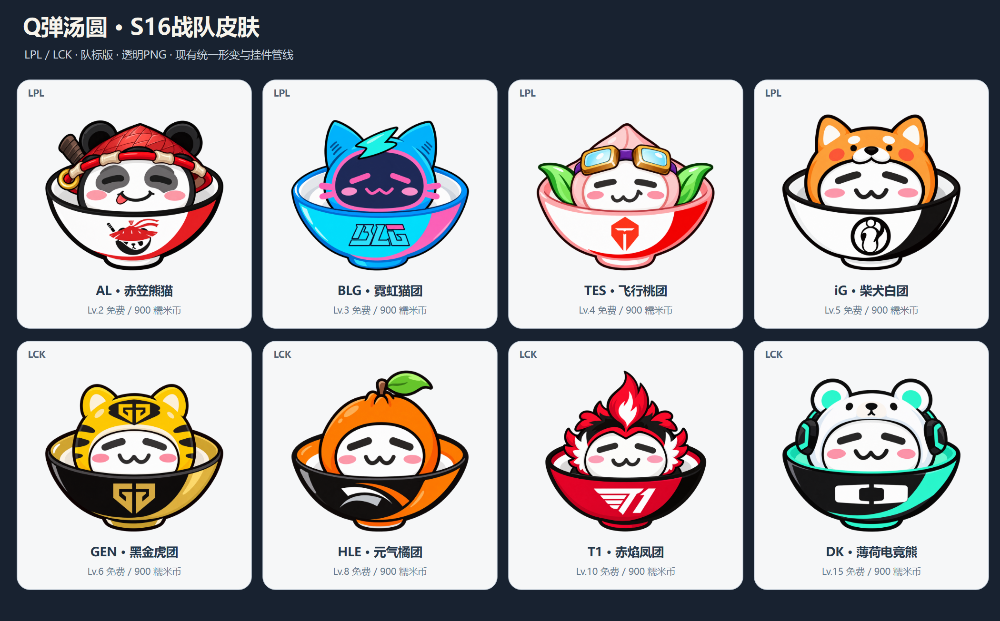

# S16 战队汤圆皮肤

这是Q弹汤圆2.0的正式内置资源，随本次源码发布入库。八款皮肤可通过等级或游戏币获得，界面名称只显示外观昵称。

## 收集方式

每款可在下列等级免费获得，也可在「商城 → 战队与装扮」花 **900 糯米币**提前永久购买。重复购买不再扣币，达到等级不会再次收费。皮肤归属、当前选择、独立大小和挂件偏移写入原存档。

| 赛区 | 战队 | 皮肤 ID | 外观 | 免费等级 |
| --- | --- | --- | --- | --- |
| LPL | AL | `team_s16_al` | 赤笠熊猫，红白碗与熊猫队徽 | 2 |
| LPL | BLG | `team_s16_blg` | 霓虹猫团，青蓝与粉色，碗面为图形化 BLG 队徽 | 3 |
| LPL | TES | `team_s16_tes` | 飞行桃团，桃子帽与护目镜，碗面盾形队徽 | 4 |
| LPL | iG | `team_s16_ig` | 柴犬白团，黑白碗与圆形队徽 | 5 |
| LCK | GEN | `team_s16_gen` | 黑金虎团，黑金碗与金色队徽 | 6 |
| LCK | HLE | `team_s16_hle` | 元气橘团，橘子帽与翼形队徽 | 8 |
| LCK | T1 | `team_s16_t1` | 赤焰凤团，红黑碗与翼形 T1 队徽 | 10 |
| LCK | DK | `team_s16_dk` | 薄荷电竞熊，耳机与几何 D+ 队徽 | 15 |

名单核对：[Riot S16 官方赛事指南](https://lolesports.com/en-GB/news/worlds-2026-primer)。参考图中的 KT 未照搬，当前系列采用参赛名单中的 DK。碗上使用队徽图形，不额外排版战队名称；BLG/T1 队徽自身包含的字母形状保留。

## 文件与运行

每个文件夹有 `manifest.json` 和一张透明 `idle.png`。这是 **8 张基础皮肤**，目前没有另外绘制 32 张表情差分；开心、眩晕、饿扁共用 idle 素材，仍会执行统一形变、染色、旋转及挂件管线。

原始正式 PNG 保持生成分辨率，加载器按现有规则将渲染纹理最大边约束到 512px。原图保留，不因运行缩放而改写。所有 PNG 有真实透明 Alpha，不含截图中的视频界面或水印。

`asset_index.json` 记录逐图尺寸、透明像素、SHA-256、等级和价格；`generation_prompts.json` 记录实际 imagegen 生成与队徽修订提示词。图片由内置图像生成工具根据用户参考图重新绘制，六张另以公开队徽作局部修订。队徽用于同人识别，未宣称俱乐部官方作品或取得其授权。

内置资源与用户导入素材分离：本目录只读；旧个人素材仍在 `assets/skins/user_<id>/`，继续被 Git 与便携包排除。游戏备份只存内置皮肤 ID 和所有权，不重复打包本目录 PNG。打包工具有明确资源白名单。

## 队徽参考

- [AL 官方战队页](https://lolesports.com/en-US/teams/anyones-legend) · [队徽](https://static.lolesports.com/teams/1641199582689_.png)
- [BLG 官方战队页](https://lolesports.com/en-US/teams/bilibili-gaming) · [队徽](https://static.lolesports.com/teams/1682322954525_Bilibili_Gaming_logo_20211.png)
- [TES 队徽](https://static.lolesports.com/teams/1592592064571_TopEsportsTES-01-FullonDark.png)
- [iG 官方战队页](https://lolesports.com/en-US/teams/invictus-gaming) · [队徽](https://static.lolesports.com/teams/1634762917340_300px-Invictus_Gaming_logo.png)
- [GEN 队徽](https://static.lolesports.com/teams/1773829250929_GENGLOGO_GOLD.png)
- [HLE 官方战队页](https://lolesports.com/en-US/teams/hanwha-life-esports) · [队徽](https://static.lolesports.com/teams/1631819564399_hle-2021-worlds.png)
- [T1 官方战队页](https://lolesports.com/en-US/teams/t1) · [队徽](https://static.lolesports.com/teams/1726801573959_539px-T1_2019_full_allmode.png)
- [DK 官方战队页](https://lolesports.com/en-US/teams/dwg-kia) · [队徽](https://static.lolesports.com/teams/1673260049703_DPlusKIALOGO11.png)

## 验收

见 [S16 战队皮肤与赛事物品验收](../../../docs/S16战队皮肤与赛事物品验收.md)。

当前切换入口：背包 → 换装 → 皮肤。2.0已移除自定义导入与管理界面；个人素材仅保留旧档兼容，不随仓库上传。
