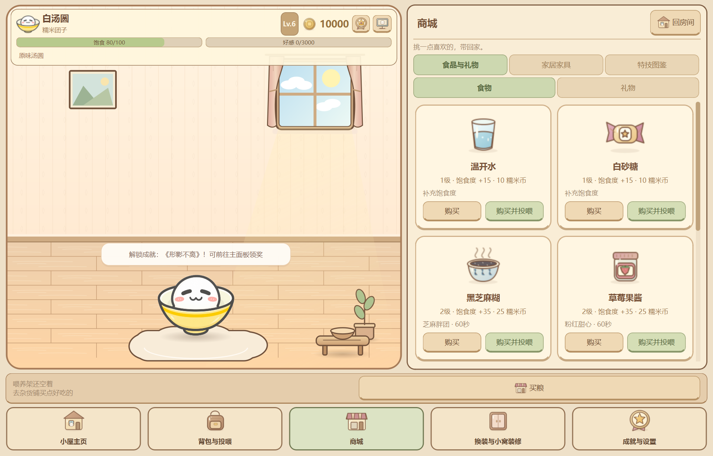
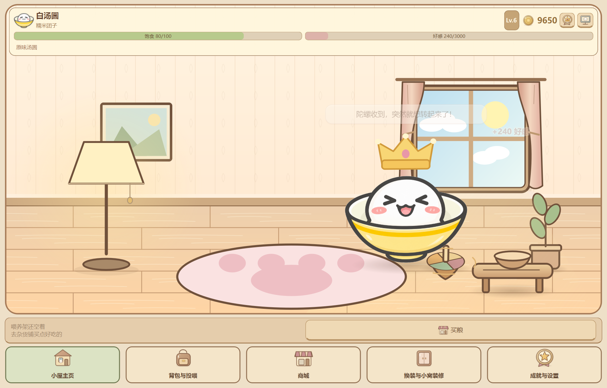
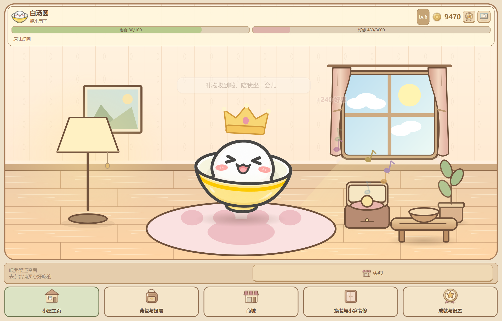

# Phase 5A 本地验收

本轮范围：主窗口内同屏抽屉、紧凑HUD与导航、房间美术统一、自主日常、四款礼物演出和投喂反馈。Phase 5B 等本轮验收后再启动。

## 启动

先在托盘退出旧进程，更新后再打开原桌面图标即可使用正式存档。建议以下独立沙箱验收，不影响正式养成：

    Set-Location -LiteralPath 'D:\Codex\Q弹汤圆'
    .\.venv\Scripts\python.exe main.py --demo --dev-mode

每次 --demo 创建新档。终端会打印存档位置；需要延续时用 --resume-demo 加该真实路径，不能同时加 --demo。--dev-mode 缩短日常等待与养成计时；不要在正式存档里开启加速做耗饥饿测试。初始100币，若不足买礼物，可先领取新手成就奖励，或等每10秒的加速在线收益自动入账。

## 1. 同屏换装与装修

1. 启动第一眼是房间和汤圆。点击背包、商城、装扮、成就，功能页都在同一个主窗口右侧打开；房间、HUD、喂养架和底部导航保留，不出现第二个功能窗口。
2. 商城→家居家具购买荷叶垫或猫爪毯。换装与小窝装修→小窝装修，点击拥有的家具卡片布置，左侧房间立即改变。暖灯布置后可点击灯或开关按钮，观察光晕。
3. 在装扮的挂件页选择已解锁的皇冠并调整高度。房间实时跟随，不用收起抽屉。开发模式可在特技页开启全部等级特权试用。
4. 缩到约820×650逻辑像素，确认房间、抽屉和五个底部导航都可见，商城长列表只在抽屉内滚动。原80px物品插画保持，导航为80px高的紧凑款。
5. 点击“回房间”收起抽屉；主窗关闭只隐藏，托盘双击再次打开默认回小窝。

## 2. 自主日常与时段

1. 回房间后不操作，正常约16～28秒等待一次活动，加速模式约4秒：去茶几闻饭、走向窗边看云朵/月亮、打盹后伸懒腰，有玩具时会凑过去看看。
2. 不想等待时，在成就与设置→游戏设置底部“房间日常预览”点击“去看看窗外”“打盹与伸懒腰”或“去茶几闻一闻”。这组按钮仅 --dev-mode 可见；如正在饿扁、拖拽或表演特技，先恢复正常。
3. 打盹约5秒，随后约2秒伸懒腰并回弹。普通台词低频出现，结合本机早晨/午后/夜晚/深夜与饱食、好感；zZ只提示一次。
4. 戳一戳、右键摸头或喂食会打断闲逛，互动台词优先。隐藏主窗后房内动画暂停，不补算离线收益。
5. 显示桌宠并固定在任意位置。观察房内溜达/打盹时，桌宠不会被拖到房间里的坐标；拖拽、眩晕、饿扁和显式特技优先于房间自主动作。

## 3. 陀螺与八音盒

1. 商城→食品与礼物→礼物，点击陀螺“购买并赠送”，或先购买再从背包赠送。地板出现彩色旋转陀螺、轻微游移与旋转轨迹；汤圆约2.6秒凑近轻碰，陀螺明显加速，演出约10秒。
2. 赠送八音盒，观察盒盖打开、彩色音符缓缓上升，汤圆随节拍左右摇摆，约12秒后收尾。
3. 再试折纸星星（环绕追光）与小花束（闻花、轻摇与花瓣），均约10秒，四款礼物使用各自演出。
4. 连续送礼可排队展示，显示队列有上限。金币、库存、赠礼次数与经验只在成功消费时结算一次；演出不会再扣一次。送礼不恢复饱食、饿扁时也不会代替喂饭。

## 4. 食物与已有功能

1. 使用喂养架、背包或商城直接投喂，图标沿弧线飞向汤圆、茶几碗内出现对应食物，汤圆连续Q弹咀嚼，头顶浮出实际增加的饱食。
2. 例如94饱食喂+15的温水，实际只显示+6饱食；100时显示“已经吃饱啦”。食物不加好感；礼物显示实际好感，Lv.30不显示未获得的经验。
3. 试黑芝麻1.2倍、草莓染色/光点、自定义GIF戴皇冠、空翻与固定桌宠，确认同屏操作与现有渲染互不冲突。
4. 退出后用 --resume-demo 继续同一档，核对家具、挂件、背包、皮肤和数值恢复。自主日常和礼物演出属于临时场景动画，重启重新安排，不写入存档。

## 自动验证与证据

    $env:QT_QPA_PLATFORM = "offscreen"
    .\.venv\Scripts\python.exe -B -m unittest discover -s tests -p "test_phase*.py"
    $env:QT_QPA_PLATFORM = "windows"
    .\.venv\Scripts\python.exe -B tests/verify_phase5a_native.py
    .\.venv\Scripts\python.exe -B tests/verify_illustrated_native.py

2026-10-22实际结果：423项完整回归全过；Windows 150%DPI原生同屏/礼物/日常/双状态GIF与48次商城按钮视口检查通过，跨进程恢复通过。

自动化报告、截图和跨进程档案在 tests/artifacts/各次时间目录中，仅本地保留。原生脚本需Windows桌面环境；离屏单元测试不代表实体多显示器或所有DPI均已实测。

