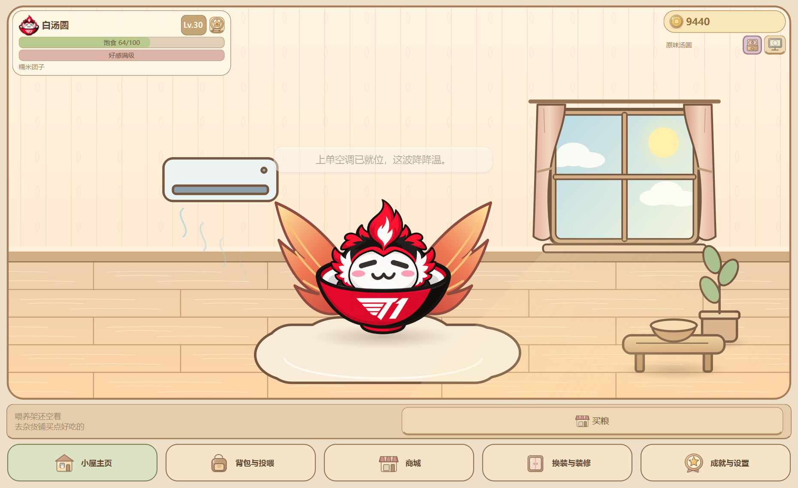
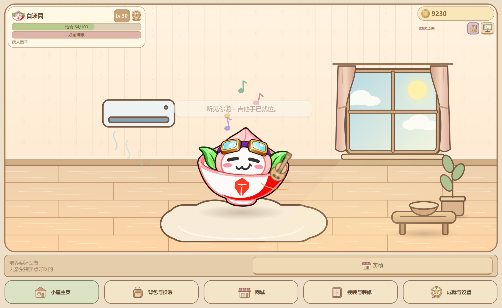
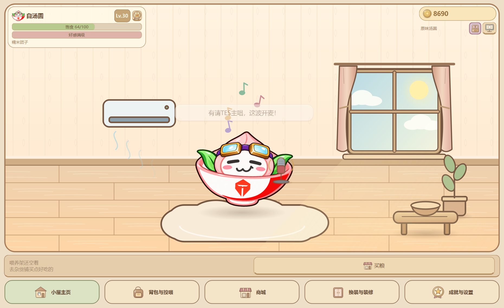

# S16 战队皮肤与赛事物品验收

2026-10-23：本地开发内容，等待用户统一发布 2.0。当前对外 1.0 的标签、版本号、已发布代码和 EXE 均未更新；本轮没有 Git 提交、推送、Release 或远程设置操作。

## 启动

先从托盘退出旧进程，避免同档单实例唤醒旧程序。PowerShell：

```powershell
Set-Location -LiteralPath 'D:\Codex\Q弹汤圆'
.\.venv\Scripts\python.exe main.py
```

独立验收档（不影响玩家存档）：

```powershell
.\.venv\Scripts\python.exe main.py --demo --dev-mode
```

开发设置可临时试用全部等级特权。真实免费发放与正式保存由实际等级决定，关闭试用会撤回未获得的皮肤并恢复白汤圆；已花币购买或实际等级解锁的皮肤仍保留。演示档加速在线收入也可用于试买。等级调试按钮会改变当前演示档等级，勿拿正式档测试重置。

## 八款战队皮肤

「商城 → 战队与装扮」展示真实皮肤缩略图、等级与购买/换上按钮；「换装与装修 → 皮肤衣橱」也能切换已拥有的皮肤。

| 皮肤 | 免费等级 | 提前购买 |
| --- | --- | --- |
| AL 赤笠熊猫 | Lv.2 | 900币 |
| BLG 霓虹猫团 | Lv.3 | 900币 |
| TES 飞行桃团 | Lv.4 | 900币 |
| iG 柴犬白团 | Lv.5 | 900币 |
| GEN 黑金虎团 | Lv.6 | 900币 |
| HLE 元气橘团 | Lv.8 | 900币 |
| T1 赤焰凤团 | Lv.10 | 900币 |
| DK 薄荷电竞熊 | Lv.15 | 900币 |


任选皮肤调大小与挂件高度，再切换回来；大小和偏移应分别恢复。双视图同步，呼吸、回弹、风味、固定位置及通用特技继续生效。碗面为队徽；当前每队只有一张基础图，表情状态使用该图回退，不虚构额外表情差分。

退出重启后检查选择、所有权、大小和偏移；同款不重复扣费。低等级玩家可先买内置皮肤，无需先解锁「导入自己的图片」权限。内置素材不能重命名或回收，个人导入仍可管理。

## 新增物品与称号

| 类别 | 商品 | 价格 | 作用 |
| --- | --- | --- | --- |
| 家具 | 上单空调 | 360币 | 墙面槽位；直接点击开关，吹出缓慢气流，记住开关状态 |
| 1级食物 | 鸡蛋 | 30币 | 饱食度+15，零好感 |
| 3级食物 | 酒桶 | 135币 | 饱食度+65，零好感；短时暖麦色/1.08倍「酒桶肚」 |
| 永久装扮 | 凤凰翅膀 | 1200币或Lv.15免费 | 独立背部图层，红金羽翼缓慢扇动，可与头饰共同佩戴 |
| 2级礼物 | TES专属吉他 | 210币 | 好感+80；约7秒持琴摇摆、拨弦弧线与彩色音符 |
| 3级礼物 | TES专属麦克风 | 540币 | 好感+240；约7秒开麦摇摆与彩色音符 |

吉他和麦克风在「商城 → 食品与礼物 → 礼物」。可以先买入背包，但只有换上 **TES飞行桃团** 才能赠送；换其他皮肤时按钮禁用，底层也会拒绝，库存/余额不受失败使用影响。它们是消耗型礼物；永久皮肤与翅膀不消耗。

称号「世一汤」在 Lv.10 获得，「金汤良圆」在 Lv.20 获得，去称号格子选择佩戴；既有称号和 Lv.6「阿一古」保留。

酒桶风味正常60秒，开发加速下15秒。各项饱食/好感仍受上限约束，满级不再虚增经验。翅膀也支持默认皮肤和用户 PNG/GIF；最大1.5倍皮肤、1.2倍风味及偏移极值有绘制边界回归。







## 两句新对白

- 换上战队皮肤时：「我们会创造新的历史」。
- 6～10时的低频日常（饱食度不低于35）：「太阳升起了，大脑空空」。低饱食提示具有优先级，不刷屏。

两句的灵感归因来自用户说明，不把游戏二创文案当作已独立核实的逐字采访记录。空调、鸡蛋、酒桶与凤凰翅膀用原创插画；TES乐器使用既有原创程序化音乐音效，不嵌入商业歌曲录音。

## 存档与资源边界

沿用 save schema 5；旧余额、等级、背包、成就、桌宠位置、房间配置和个人皮肤保留。新增 `owned_team_skins`、`purchased_accessories`、`air_conditioner_on`；背部挂件字段按需保存，不破坏旧四槽数据。既有 `skin_configs` 接受八款内置 ID。

备份/恢复保存皮肤归属和选择，不复制内置大图；跨进程恢复已验证。新增打包白名单只收正式内置目录，个人 `user_*`、预览、存档和原始参考资料继续排除。本次没有覆盖原四张汤圆图、个人皮肤或正式玩家存档，没有重新构建 EXE。

## 自动验证

```powershell
$env:QT_QPA_PLATFORM='offscreen'
.\.venv\Scripts\python.exe -B -X utf8 -m unittest discover -s tests -p 'test_*.py' -v
```

新增 `tests/test_s16_collection.py` 覆盖等级免费发放、提前购买与重复扣费防护、开发试用撤回、旧档校验、独立大小/偏移、透明素材回退、内置只读管理、跨进程备份恢复、食物/专属礼物约束、翅膀边界、空调开关、称号、精确对白、独立图标、场景前景乐器及打包白名单。完整执行结果见[开发日志](开发日志.md)本轮记录。

Windows原生截图使用隔离测试档并通过真实模型调用触发演出；截图已目视复核。本轮静音运行，不声称真人听感、另一台电脑、多屏实体设备或新便携包已验证。
