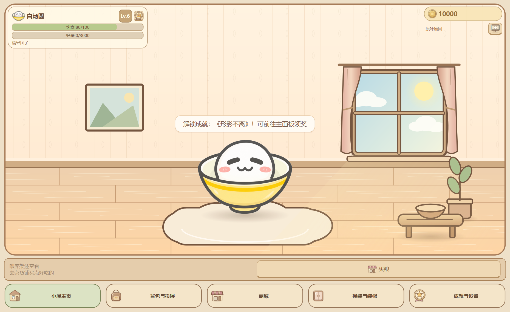
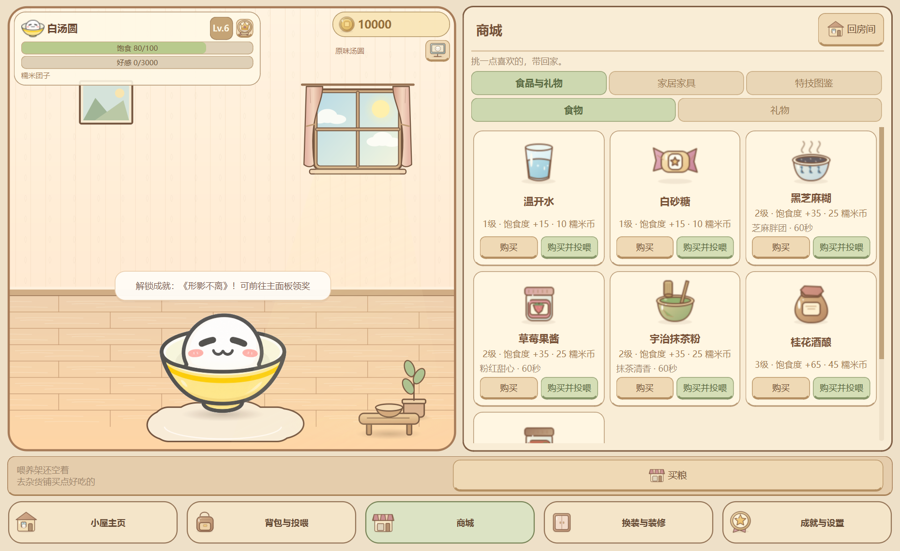
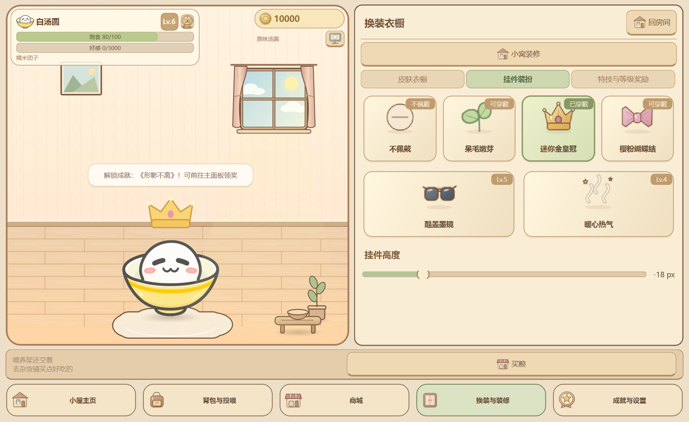
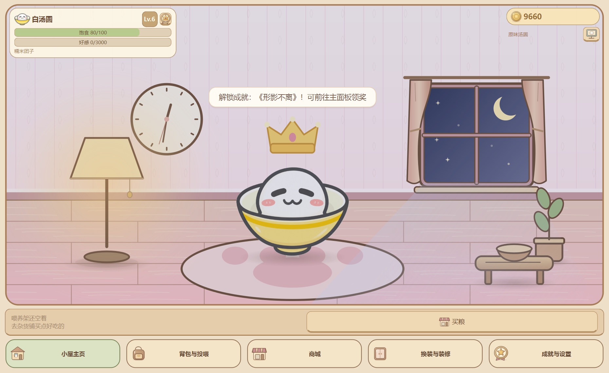

# V2 第一步：同屏抽屉与房间视觉验收

本轮继续打磨Phase5A已有功能：分离式浮动HUD、浅型Dock、平滑同屏抽屉、响应式卡片、完整环境光和窗外微动态。原有日常/赠礼保留；第二步互动与音效、第三步独立皮肤配置和Lv7～30目标等待后续指令。

## 启动

先从托盘退出旧进程，再从原桌面图标启动更新后的源码版。以下命令创建独立演示档，适合反复验收：

    Set-Location -LiteralPath 'D:\Codex\Q弹汤圆'
    .\.venv\Scripts\python.exe main.py --demo --dev-mode

--demo不使用正式档。--dev-mode显示等级试用及昼夜预览；若只检查界面，可在游戏设置关闭“加速养成计时”，仍能使用昼夜预览，避免长时间验收时饱食快速下降。已有便携ZIP不会自动改变，本轮源码更新需重新打包后才能带给朋友。

## 验收顺序

1. **主页占比与HUD**：默认1240×760逻辑像素，房间约占80%面积；左上角色信息卡、右上糯米币胶囊与桌宠开关分离，中央墙面不再盖通栏底框。底部五导航为62px高的浅型Dock。
2. **同屏抽屉**：依次打开背包、商城、换装、装修、成就、设置，均在主窗口右侧展开，房间、汤圆与底部导航保留。开合约220ms；快速点不同导航也不会残留浮窗或错误收起。点击“回房间”恢复大场景。
3. **实时换装**：换装与装修→挂件装扮，选择已解锁皇冠并拉动高度滑块，左侧汤圆立即变化。开发模式可在特技页开启全部等级特权试用。滑块聚焦后按左右键仍可调整；按钮、标签和滑块不再出现系统黑色虚线框。
4. **实时装修**：商城→家居家具购买，再从换装与装修→小窝装修点击卡片布置，地毯/主题/摆件即刻在旁边房间更新。演示币不足可领取成就或等待自动收入。原始黄色汤碗皮肤保持，额外食盆在侧边茶几，不与汤圆重叠。
5. **多列与小窗**：主窗宽约1240时商城三列，约820/1000时两列；背包、挂件、家具、称号、特技和成就按可用视口重排。购买/投喂按钮完整，滚动条细窄圆润，稀疏背包不留空槽。将窗口缩到约820×650，确认房间与五导航仍可见。
6. **昼夜微动态**：成就与设置→游戏设置→底部“昼夜环境预览”，切白天看缓慢移动的云朵和地板阳光；切夜晚看完整房间及汤圆的轻柔夜色、斜射月光和缓慢闪烁的星星。点击“随电脑时间”恢复自动模式；不修改电脑时间、不写存档，重启默认恢复自动。
7. **灯与挂钟**：布置暖心落地灯，直接点击房间里的灯，观察暖橘光晕开/关；布置糯米挂钟，核对三根指针与电脑当前时间一致，秒针持续走动。
8. **兼容性**：尝试自定义GIF、1.2倍风味、皇冠/偏移、原地空翻、桌宠固定/拖拽和退出重启；既有养成与存档规则保持。

正常昼夜按本机当地6≤hour<18为白天；临时预览只用于当前运行。场景隐藏时环境动画暂停，显示时继续，不补算离线养成。

## 自动验证

    $env:QT_QPA_PLATFORM = 'offscreen'
    .\.venv\Scripts\python.exe -B -m unittest discover -s tests -p 'test_phase*.py'
    $env:QT_QPA_PLATFORM = 'windows'
    .\.venv\Scripts\python.exe -B tests/verify_v2_step1_native.py
    .\.venv\Scripts\python.exe -B tests/verify_illustrated_native.py

原生验收独立建档，覆盖三种宽度、六页同屏、102次商城按钮完整视口检查、皇冠/高度与装修实效、云朵/星光帧变化、灯点击和实际挂钟；原插画脚本继续检查GIF特技及跨进程恢复。证据在tests/artifacts/各次时间目录，仅本地保留。实测Windows原生150%DPI；实体多显示器及其他电脑未测试。

## 本轮实测记录

2026-10-22：440项完整回归全过；原生Windows150%DPI验收通过，主页房间面积比例79.6159%，三种宽度六类页同屏、102次商城按钮完整视口检查与跨进程恢复均通过。详细真实错误及修改清单见开发日志；测试产物在本地tests/artifacts/保留。
