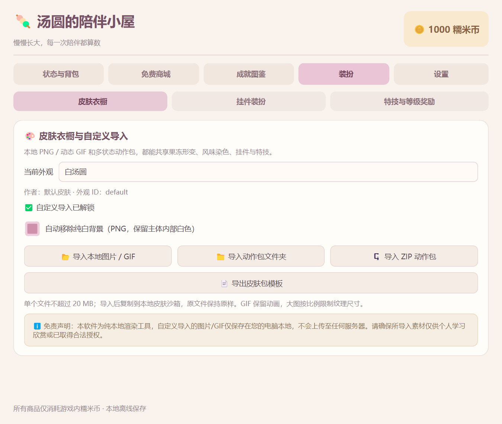
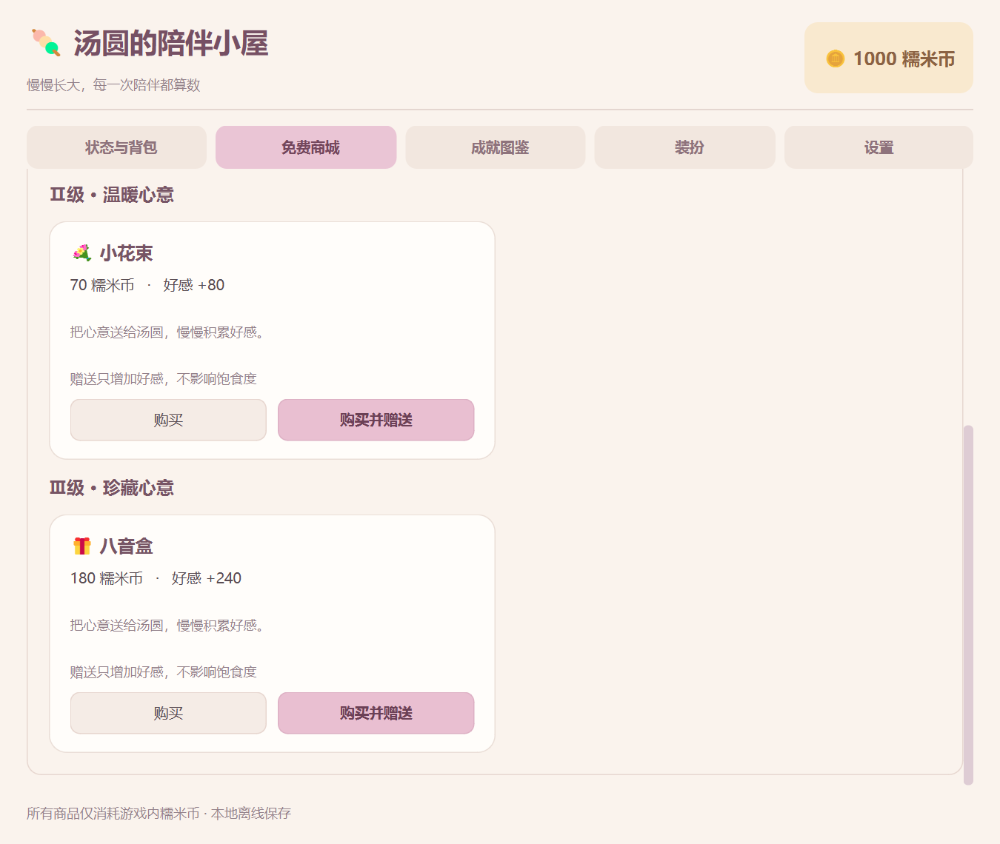

# 养成平衡与导航更新验收（2026-10-16）

当前版本将主面板拆为五个主标签，食物和赠礼各分三级，并提高升级所需经验。历史 Phase 2～4 指南记录各阶段原始数值；日常使用以本指南及 README 为准。

## 启动与存档

先从旧程序托盘选择“退出程序”，再双击 D:\虚拟C盘\Q弹汤圆.lnk。快捷方式继续使用项目源码，无需重建。终端启动：

    Set-Location -LiteralPath 'D:\Codex\Q弹汤圆'
    .\.venv\Scripts\python.exe main.py

不影响正式进度的独立体验：

    .\.venv\Scripts\python.exe main.py --demo

正常模式每 288 秒扣 1 点饱食度，满值 100→0 共 8 小时在线时间；初始 80 对应 6 小时 24 分。关闭与长时间休眠不追扣。--dev-mode 或设置中的测试加速会改为 2 秒/点，验收 8 小时规则时务必关闭加速。

存档版本 1～4 自动升级至 5。首次写回先在同目录以 save_data.json.bak.时间 创建原字节备份，不反复备份；保留等级、原始 EXP、币、背包、皮肤、挂件、位置及未知字段。旧“汤圆守护神”含原星星前缀的称号和佩戴选择自动转成“阿一古”。本次自动化与原生验证均使用隔离存档。

## 手动检查

1. **导航与对齐**：双击汤圆。顶部依次为状态与背包、免费商城、成就图鉴、装扮、设置，整体左右与标题下横线对齐。调整窗口宽度并反复切换，文字应清晰。装扮内再分皮肤衣橱、挂件装扮、特技与等级奖励；固定 / 复位 / 测试开关在独立设置页。
2. **食物分级与无经验**：商城筛选“三级食物”，按下表检查数值。记下经验，买入背包后从状态页投喂；饱食度增加且不超过100，EXP完全不变。右键白砂糖也只恢复15点，花10币。风味仍可染色、放大或触发辣油行为。
3. **赠礼闭环**：商城筛选“三级礼物”。先点击折纸星星“购买”，只扣20币并存入背包，不发EXP；状态页点击“赠送”，消耗一件并加20 EXP。另试“购买并赠送”，一次扣款并生效，累计赠礼次数实时增加；投喂次数与挂机礼包次数各自保持独立。
4. **真实饿扁与用途区分**：设置中调试饥饿归零，汤圆压扁。赠送礼物只加好感，仍然饿扁；投喂任一级食物立刻恢复，EXP不变。礼物不会替换已有风味。
5. **升级难度与奖励**：Lv.1 显示0/500，Lv.2所需1000，Lv.3所需1500，依此类推；原有等级与已积累经验按原值保留，进度条占比随新门槛降低。跨门槛自动保留余量并奖励30币；等级上限仍为30。点击、摸头、挂机礼包和空翻原有经验来源继续有效。
6. **Lv.6称号**：已达到Lv.6或持有旧称号的存档，状态页称号列表和等级奖励应显示“阿一古”，可佩戴，重启仍保持。--demo --dev-mode 可在装扮→特技与等级奖励中试用全部特权，真实等级不会被伪造。
7. **装扮兼容与恢复**：装扮→皮肤衣橱导入本地GIF；到挂件装扮选择皇冠并调整偏移；到特技与等级奖励表演空翻。GIF保持播放、皇冠跟随。退出重开同一份演示存档（使用终端输出的 --resume-demo 路径），皮肤、挂件、偏移、礼物库存和赠礼计数应恢复。

| 类别 / 级别 | 商品 | 价格 | 使用效果 |
| --- | --- | --- | --- |
| 食物Ⅰ | 温开水、白砂糖 | 各10币 | 饱食度+15，EXP+0 |
| 食物Ⅱ | 黑芝麻糊、草莓果酱、宇治抹茶粉 | 各25币 | 饱食度+35，EXP+0，原风味效果 |
| 食物Ⅲ | 桂花酒酿、变态辣油 | 各45币 | 饱食度+65，EXP+0；辣油保留风味与行为 |
| 礼物Ⅰ | 折纸星星 | 20币 | 好感+20，饱食度不变 |
| 礼物Ⅱ | 小花束 | 70币 | 好感+80，饱食度不变 |
| 礼物Ⅲ | 八音盒 | 180币 | 好感+240，饱食度不变 |

挂机礼包与每日掉币仍可获取免费代币；余额不足时购买按钮禁用。满级保持MAX，不继续累加EXP。

## 自动化与实际设备结果

    .\.venv\Scripts\python.exe -B -X utf8 -m unittest discover -s tests -p 'test_phase*.py'
    .\.venv\Scripts\python.exe -B -X utf8 tests\verify_balance_native.py
    .\.venv\Scripts\python.exe -B -X utf8 tests\verify_phase4_native.py

- 完整287项回归通过；新增25项覆盖8小时模型时间、10倍门槛、食物 / 赠礼各级效果、无经验投喂、饥饿时赠礼、越级奖励、旧称号与v4→v5备份、累计统计和界面层级。
- Windows单屏150%缩放原生进程，20次真实标签鼠标切换；700 / 900 / 1100逻辑像素宽下左右边缘均与横线一致。五主标签 / 三装扮子页截图已经目视检查。
- 原生购买→背包赠送→直接赠送、食物恢复 / 不加经验、赠礼不能解除饿扁、升级奖励一次、旧Lv.6 / EXP287 / 称号迁移、独立进程重启后的库存 / 赠礼计数 / 皇冠偏移均通过，退出码0、stderr空。
- GIF皇冠与三种特技跨进程恢复、旧养成真实加速计时、原商城 / 成就 / 辣油固定自由模式检查通过；普通与--demo --dev-mode冒烟均退出0、stderr空。
- 8小时为模型推进精确验证，未等待实际8小时。测试环境Python3.12.6 / Qt6.8.3；Python3.10仅做语法兼容检查，未实机运行；未实测多台物理显示器。

## 本次文件清单

实际更新或新建的项目文件如下；源码与文档均在项目根目录内，运行数据和导入素材不参与提交。

- D:\Codex\Q弹汤圆\README.md
- D:\Codex\Q弹汤圆\config\catalog.json
- D:\Codex\Q弹汤圆\dashboard.py
- D:\Codex\Q弹汤圆\docs\images\balance-dressing.png
- D:\Codex\Q弹汤圆\docs\images\balance-gifts.png
- D:\Codex\Q弹汤圆\docs\养成平衡更新验收.md
- D:\Codex\Q弹汤圆\docs\开发日志.md
- D:\Codex\Q弹汤圆\docs\目录说明.md
- D:\Codex\Q弹汤圆\docs\项目规范.md
- D:\Codex\Q弹汤圆\main.py
- D:\Codex\Q弹汤圆\models.py
- D:\Codex\Q弹汤圆\save_manager.py
- D:\Codex\Q弹汤圆\styles\theme.qss
- D:\Codex\Q弹汤圆\tests\test_phase2.py
- D:\Codex\Q弹汤圆\tests\test_phase3.py
- D:\Codex\Q弹汤圆\tests\test_phase4_balance.py
- D:\Codex\Q弹汤圆\tests\test_phase4_dashboard.py
- D:\Codex\Q弹汤圆\tests\test_phase4_models.py
- D:\Codex\Q弹汤圆\tests\test_phase4_rendering.py
- D:\Codex\Q弹汤圆\tests\test_phase4_skins.py
- D:\Codex\Q弹汤圆\tests\verify_balance_native.py
- D:\Codex\Q弹汤圆\tests\verify_phase2_native.py
- D:\Codex\Q弹汤圆\tests\verify_phase3_native.py
- D:\Codex\Q弹汤圆\tests\verify_phase4_native.py

关键配置修改前的原字节备份：

- D:\Codex\Q弹汤圆\config\catalog.json.bak.20261016-194908-334
- D:\Codex\Q弹汤圆\styles\theme.qss.bak.20261016-195031-339
