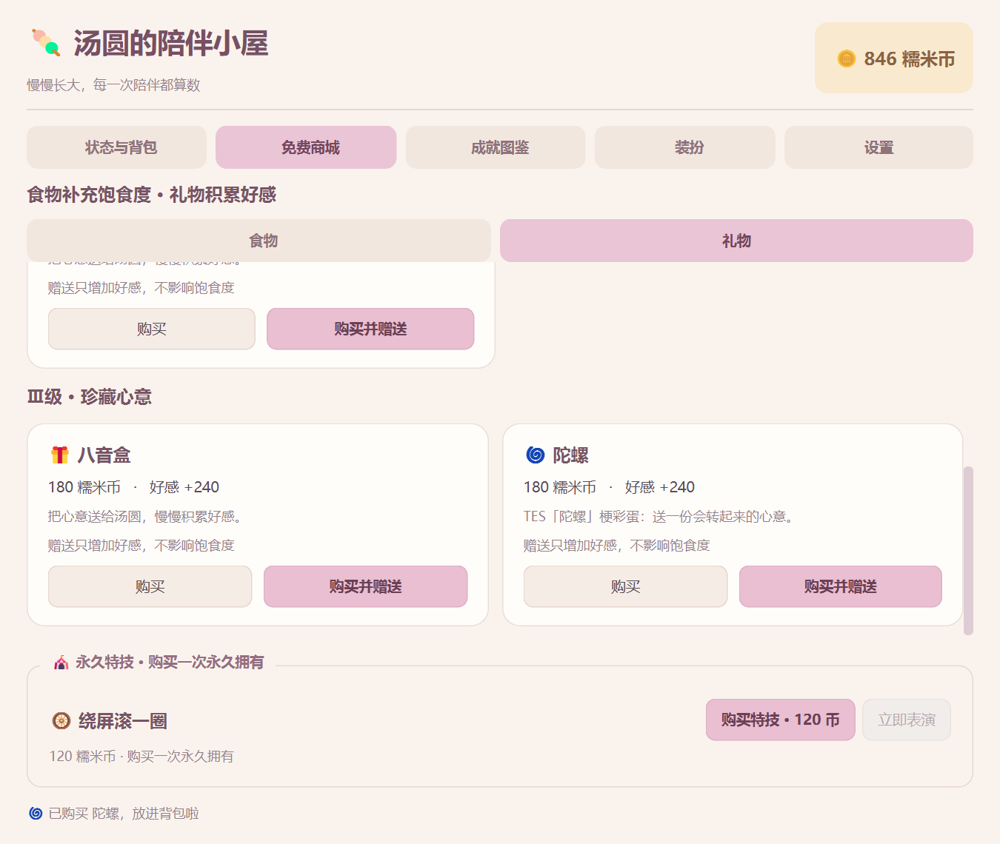

# 商城子标签、陀螺与互动台词验收（2026-10-17）

从托盘退出旧桌宠，再双击 D:\虚拟C盘\Q弹汤圆.lnk。演示模式仍可用 main.py --demo --dev-mode，不影响正式进度。

## 本次操作入口

1. 双击汤圆打开【免费商城】，现在有【食物】【礼物】两个独立子标签，各自保留滚动位置。页面底部的【永久特技】区域在两页都可见，绕屏购买/表演入口保留。
2. 在【礼物】下滚到Ⅲ级，可看到新商品【🌀 陀螺】：180糯米币、好感+240、不补饱食度，与八音盒同档。可购买入背包再赠送，或【购买并赠送】直接生效；使用库存不再次扣币。
3. 在线每90秒自动获得10～20币和5 EXP；开发加速为10秒。观察余额和“在线入账”次数即可，无需点击汤圆或气泡。每日戳戳随机掉币也直接入账，不覆盖台词。独立升级/成就通知仍保留。
4. 戳一次汤圆，应说“别急别急。”，即使这次随机掉币也一样。单击仍有200ms确认窗口；双击打开面板，不误计收益。
5. 将饱食度调至100后喂食，应说“别吃，别吃，饿吗，饿死了吗。”。判定的是投喂前已经100；从95吃到100仍使用普通进食台词。满饱仍沿用原有消耗与风味规则，食物EXP为0。
6. 拖拽、摸头、眩晕、赠礼、饿扁恢复、落地和各特技都有对应短句。连续戳戳会替换同一条互动，不积压十几条重复消息。
7. 重启后检查陀螺库存、赠礼/在线入账统计及币数。旧档中的未领金币按原金额在启动时自动结算一次（含原有5 EXP和跨级奖励）；写回后pending_reward归零，下次重启不再重复给。没有离线追补新收益。

## 实装台词与来源说明

| 场景 | 当前台词 | 说明 |
| --- | --- | --- |
| 戳一戳 | 别急别急。 | 用户指定 |
| 已满饱食度投喂 | 别吃，别吃，饿吗，饿死了吗。 | 用户指定 |
| 普通进食 | 吃一点，慢慢来。 / 这口糯米，舒服了。 | 汤圆场景改写 |
| 饿扁后投喂 | 这波有救了，我又能弹了！ | 汤圆场景改写 |
| 摸头 | 太舒服了！ / 这个摸摸头，可以的。 | 短句参考及场景改写 |
| 普通赠礼 | 礼物收到啦，陪我坐一会儿。 / 心意收下，今天也一起玩吧。 | 汤圆场景改写 |
| 赠送陀螺 | 陀螺收到，突然就想转起来了！ | TES陀螺主题的原创互动句 |
| 拖拽 | 你们是来抓我的吗？ | 参考TheShy本人账号视频标题 |
| 落地 | 这波完美呀，哦 | 汤圆场景改写 |
| 连戳眩晕 | 阿一古，头都转晕啦！ | 汤圆场景改写 |
| 饥饿提醒 | 这波真的饿了，给我留一口。 | 汤圆场景改写 |
| 空翻 | 看我操作，先转一圈！ | 汤圆场景改写 |
| 分身 | 分身拉开，快乐加倍。 | 汤圆场景改写 |
| 芝麻球 | 接住这颗芝麻球！ | 汤圆场景改写 |
| 绕屏 | 绕屏走位，转一圈就回来。 | 汤圆场景改写 |

台词在 config/catalog.json → dialogues 中集中维护，重启生效。轮换用独立游标，不消耗收入随机数，不影响掉币概率。用户补充的项目创意语境为LoL圈内汤圆与炫神传播；未将该背景记成美术作者身份等未提供事实。

搜索参考：

- [TheShy本人账号：你们是来抓我的吗？](https://www.bilibili.com/list/1923246745?bvid=BV1uBoRYREDr&oid=114240073502245)：合集页明确列出TheShy为UP主、iG为策划，并展示该标题。用于拖拽短句参考。
- [直播切片标题：做了近视手术，太舒服了](https://www.bilibili.com/video/BV1fL41187qN/)：搜索索引可读标题；用于“太舒服了”这个短句参考，摸头是本项目重新安排的情景。
- [蔚蓝边际《TES先锋赛单曲1.0〈突然的陀螺〉》](https://www.bilibili.com/list/ml330043260?bvid=BV1h5QaY5EaH&oid=114172327101336)：可读页面标明作品标题、TES标签与作者署名，用于礼物主题参考。

直达单视频页本轮部分返回412或无法抓取，已回退可访问合集页及搜索索引读取标题/元数据。以上不是逐段听录音后的字幕核验；场景改写与短句参考已区分，没有把自写句子冒称为选手逐字发言。

## 自动化及实机验证

    Set-Location -LiteralPath 'D:\Codex\Q弹汤圆'
    .\.venv\Scripts\python.exe -B -X utf8 tests\test_phase4_dialogue.py
    .\.venv\Scripts\python.exe -B -X utf8 tests\verify_shop_dialogue_native.py

完整332项通过（310项已有用例适配新规则+22项新增）：金额边界/重复领取拒绝、连续周期、旧未领跨级只结算一次、存档与计时余量、陀螺买入/使用/不加饱食、随机数独立、满饱与临界满饱分支、气泡优先/无重复互动队列、子标签与特技区域、700/900/1100宽度对齐。26份Python按3.10语法解析通过。

Windows单屏150%原生双进程验证真实10秒加速计时自动静默入账、陀螺购买/背包赠送、戳戳随机掉币仍显示指定句、满饱投喂、真实拖拽事件、长台词工作区内显示及重启恢复。Phase2/3/4、养成平衡和绕屏五组原生双进程复核全部退出0、stderr空，普通与--demo --dev-mode启动冒烟通过。截图已目视检查。

所有测试使用隔离存档；实体多屏、其他系统、Python3.10运行未实测。正式8小时衰减、10倍升级门槛和既有物理参数没有改变。

## 本次完整文件清单

- D:\Codex\Q弹汤圆\README.md
- D:\Codex\Q弹汤圆\config\catalog.json
- D:\Codex\Q弹汤圆\dashboard.py
- D:\Codex\Q弹汤圆\docs\images\shop-dialogue-full-feed.png
- D:\Codex\Q弹汤圆\docs\images\shop-dialogue-gifts.png
- D:\Codex\Q弹汤圆\docs\商城与互动更新验收.md
- D:\Codex\Q弹汤圆\docs\开发日志.md
- D:\Codex\Q弹汤圆\docs\目录说明.md
- D:\Codex\Q弹汤圆\docs\绕屏特技验收.md
- D:\Codex\Q弹汤圆\docs\项目规范.md
- D:\Codex\Q弹汤圆\main.py
- D:\Codex\Q弹汤圆\models.py
- D:\Codex\Q弹汤圆\pet_window.py
- D:\Codex\Q弹汤圆\tests\test_phase2.py
- D:\Codex\Q弹汤圆\tests\test_phase3.py
- D:\Codex\Q弹汤圆\tests\test_phase4_balance.py
- D:\Codex\Q弹汤圆\tests\test_phase4_dialogue.py
- D:\Codex\Q弹汤圆\tests\test_phase4_screen_roll.py
- D:\Codex\Q弹汤圆\tests\verify_balance_native.py
- D:\Codex\Q弹汤圆\tests\verify_phase2_native.py
- D:\Codex\Q弹汤圆\tests\verify_phase3_native.py
- D:\Codex\Q弹汤圆\tests\verify_phase4_native.py
- D:\Codex\Q弹汤圆\tests\verify_screen_roll_native.py
- D:\Codex\Q弹汤圆\tests\verify_shop_dialogue_native.py

重要配置修改前的同目录原字节备份：

- D:\Codex\Q弹汤圆\config\catalog.json.bak.20261017-231504-696
- D:\Codex\Q弹汤圆\config\catalog.json.bak.20261017-232512-973
