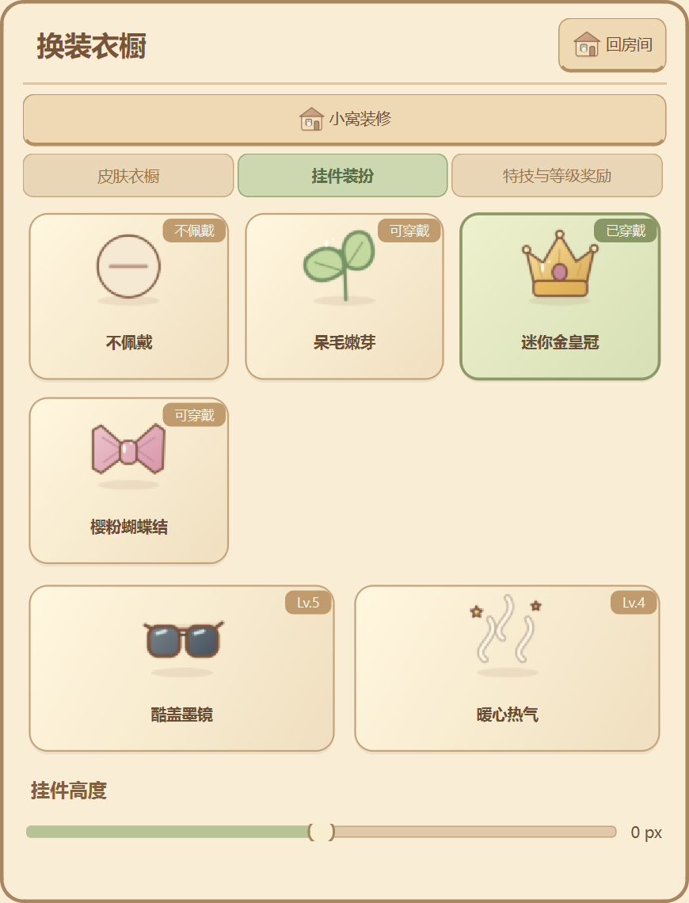
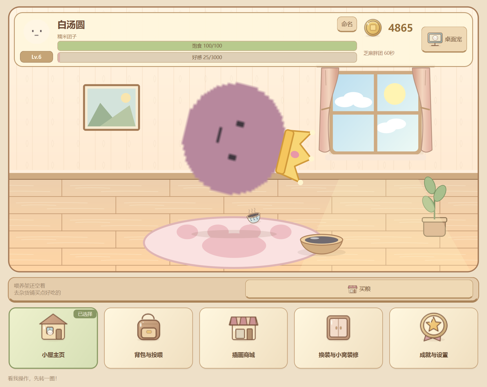

# 插画游戏界面验收（2026-10-18）

本轮修复截图中的商城裁切/重叠，并将主面板重做为房间优先的插画养成界面。

## 启动

先从旧版托盘菜单退出，避免旧进程仍显示旧界面；现有 D:\虚拟C盘\Q弹汤圆.lnk 继续有效，本次没有修改快捷方式。

PowerShell正式运行：

    Set-Location -LiteralPath 'D:\Codex\Q弹汤圆'
    .\.venv\Scripts\python.exe main.py

隔离体验（不会使用正式养成档）：

    .\.venv\Scripts\python.exe main.py --demo --dev-mode

--demo打印本次演示档路径，--dev-mode加速计时；正常饱食度仍8小时，好感仍每级×500，食品不加经验、礼物分三级，原存档全部兼容。

## 手动验收

1. **第一眼看房间**：默认进入至少420px高的房间，汤圆明显放大坐在坐垫，旁边有饭碗。看暗纹墙纸、木纹地板、窗帘、挂画、绿植、窗外昼夜。顶部头像、Lv徽章、称号、饱食/好感条、糯米币PNG和桌宠开关直接浮在房间上。
2. **五个插画导航**：底部是小屋主页、背包与投喂、插画商城、换装与小窝装修、成就与设置，每个为80px插画。左键戳房间汤圆，看果冻/开心/「急咯急咯」；右键摸头。
3. **商城不再重叠**：点插画商城，右侧打开独立纸页图鉴，房间不会被压矮。食品与礼物下有食物/礼物子页，另外有家具和特技图鉴。上下滚动看大图、名字、级别、短属性及完整购买按钮，永久特技独占一页，不再挤在食品页底部。测试覆盖图鉴500px和580px宽度所有商品按钮位于滚动视口内。
4. **背包与飞行投喂**：买一份食物进入背包，回小屋点喂养架上的插画图标，食物沿弧线飞入饭碗并出现短暂食物/碎屑反馈，汤圆开心回弹、饱食增长，只消耗一份。背包页同样是插画商品格，礼物走赠送按钮。
5. **点击图标换装**：换装与小窝装修→挂件装扮，没有下拉菜单或复选框；点嫩芽/皇冠/蝴蝶结格子穿戴，绿色高亮和「已穿戴」角标立即出现，点不佩戴收起。墨镜/热气同样点击图标开关，下面滑块调挂件高度。未解锁格子变淡并标门槛，仍遵守等级。
6. **点击格子装修**：在换装衣橱上方点小窝装修。家具按五槽展示大图格，已布置有绿色边框/角标；未拥有的先在商城家居页买入。点击房间里的落地灯或装修的灯光按钮切换暖光，重启恢复。
7. **GIF戴皇冠空翻**：普通Lv.3或50币打开本地导入；开发演示可在特技与等级奖励底部点「全部等级特权试用」。在皮肤衣橱点击大导入图标选择本地GIF，到挂件页点击皇冠，再到特技图鉴点击原地空翻。房间/GIF/皇冠/风味染色共用原管线。测试已覆盖两尺寸、四特技各31个姿态，在1.2倍+皇冠/墨镜/热气和-30偏移下完整图形位于HUD下且不越界。
8. **成就、称号与设置**：成就与设置打开大图鉴，有插画成就章、分类格和领取按钮；游戏设置入口在成就页顶部，原有固定/加速/饿扁调试改为插画按钮。称号在背包底部铭牌格切换。
9. **托盘与恢复**：主窗口关闭仅隐藏，双击托盘总先回房间；桌面宠可独立显示/隐藏。安全退出后重开正式模式或用之前打印的实际演示路径 --resume-demo，名字、币、背包、家具、灯光、自定义GIF和挂件保持。

## 替换画师图标

目录 D:\Codex\Q弹汤圆\assets\item_icons\ 包含67张真实80×80透明PNG，逐文件说明见[映射表](../assets/item_icons/README.md)。例如water.png温开水、sugar.png白砂糖、crown.png皇冠、coin.png糯米币。每图用QPainter三倍超采样、棕色圆润描边、柔和渐变、高光及底部投影绘制，未下载或依赖外部素材。

同名本地PNG优先读取，软件不覆盖已存在的画师图。替换后重启，或游戏设置点击「重新加载外观与图标」。缺失才生成；损坏图只在内存用矢量兜底，磁盘原图保留。旧档名字/自定义皮肤名字只在显示层去Emoji，不抹掉原存档。

## 验证结果

- 完整385项全绿（原有367项按新文案/导航适配 + 18项插画专项），385项最终99.529秒，退出0。原有模型/8h饥饿/等级/币/商店/存档/物理/PNG-GIF-ZIP安全覆盖保留。
- 八组Windows原生双进程检查通过：插画新验收、小窝、Phase2/3/4、养成平衡、绕屏特技、商城互动，共16进程退出0且stderr空。更新HUD边界后，小窝和插画验收再次通过。
- 67张PNG均80×80、有透明Alpha，67个文件内容各不相同；同名画师图优先/损坏不覆盖/路径非法ID不越界均有专项。
- 原生检查没有QComboBox或QCheckBox，默认及自定义名字场景下控件/菜单文字无Emoji；全部应用模块源码和catalog.json亦检查无实际Emoji字符，旧称号迁移用转义保留。
- 248个放大/挂件/特技姿态全部在房间范围内且HUD不遮挡；房间绘制不推进模型或引擎、不改保存锚点。
- 32份Python通过3.10 AST；正式/--demo --dev-mode两个冒烟退出0、stderr空。Windows单屏150%验证，其他系统/多实体屏/Python3.10解释器运行未实测。

完整结果保留tests/artifacts/illustrated-final-regression.json、illustrated-native-summary.json、illustrated-feature-verification.json，原生图片在对应illustrated-native时间目录。测试只用隔离存档和自生成GIF，默认四PNG与Git基线逐字节一致，玩家档和用户皮肤不入库。

重新自动验收：

    .\.venv\Scripts\python.exe -B -X utf8 -c "import os,unittest; os.environ['QT_QPA_PLATFORM']='offscreen'; r=unittest.TextTestRunner().run(unittest.defaultTestLoader.discover('tests',pattern='test_phase*.py')); raise SystemExit(not r.wasSuccessful())"
    .\.venv\Scripts\python.exe -B -X utf8 tests\verify_illustrated_native.py

## 改动位置

- D:\Codex\Q弹汤圆\dashboard.py：重写游戏HUD、非模态纸页图鉴、物品格、可视化选择器、换装/装修、五导航；保留原选择信号API。
- D:\Codex\Q弹汤圆\styles\theme.qss：完整替换为羊皮纸/原木/叶绿的游戏视觉与按钮反馈。
- D:\Codex\Q弹汤圆\illustrated_assets.py：新插画生成/加载/PNG优先缓存/文字过滤。
- D:\Codex\Q弹汤圆\home_scene.py：新手绘房间、变换适配、曲线食物飞行。
- D:\Codex\Q弹汤圆\assets\item_icons\：67张PNG及README映射表。
- D:\Codex\Q弹汤圆\main.py、models.py、pet_window.py、pet_engine.py、config\catalog.json：Emoji文案清理、菜单图标、显示过滤和加载联动；养成数值/存档格式不变，save_manager.py保持原实现。
- D:\Codex\Q弹汤圆\tests\test_phase5_visual.py、verify_illustrated_native.py：新增行为/原生验收，已有五份UI测试/原生脚本适配新导航与图鉴位置。
- D:\Codex\Q弹汤圆\AGENTS.md、README.md、docs\项目规范.md、docs\目录说明.md、docs\开发日志.md、docs\插画游戏界面验收.md及docs\images\illustrated-game-*.png：规则、说明、开发事实和原生预览。

## 原生预览

