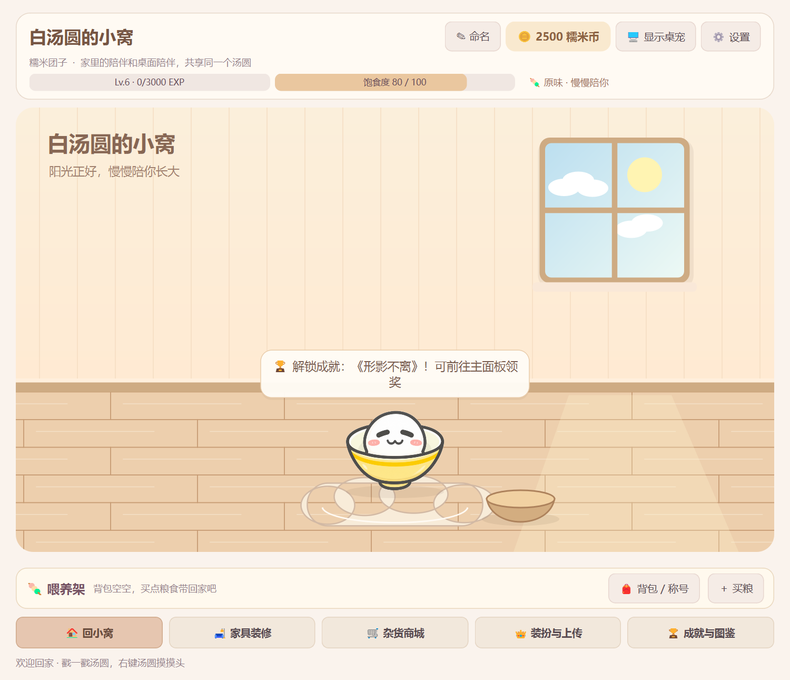
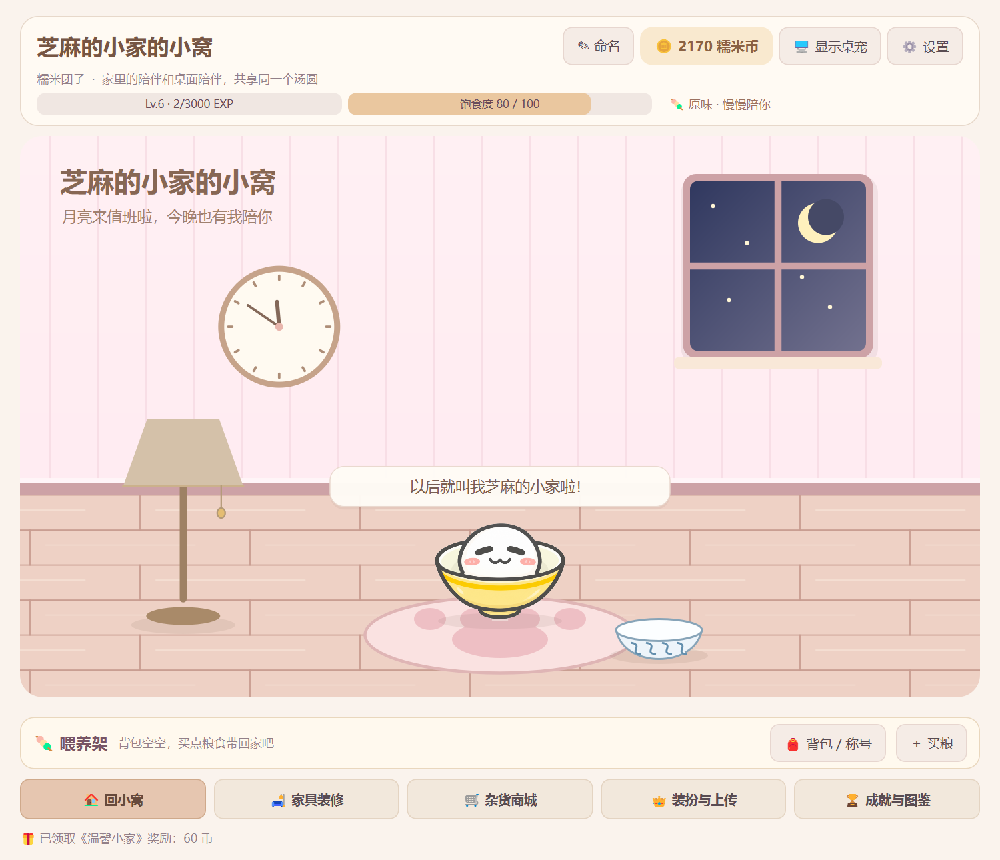
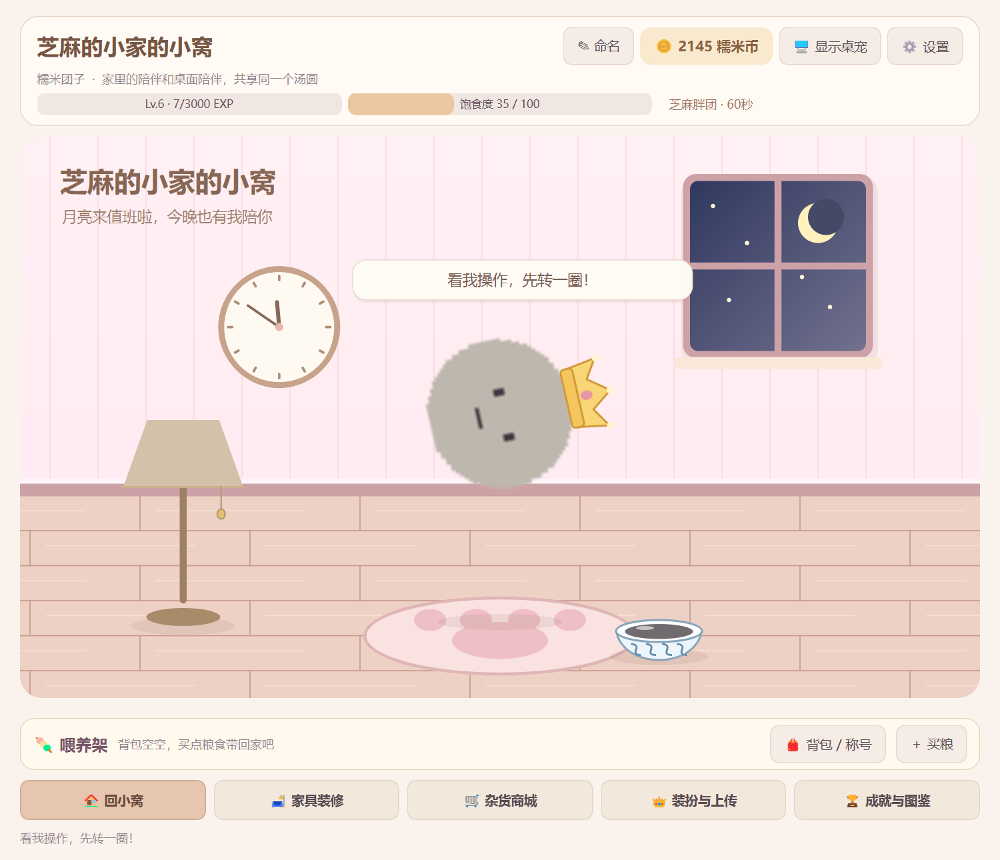

# 汤圆小窝：场景化与家具装修验收

项目：D:\Codex\Q弹汤圆。运行环境：Windows、Python3.12.6、PySide6/Qt6.8.3；核心源码保持Python3.10语法兼容。

## 启动与数据保护

先从旧版托盘菜单退出程序，再双击既有 D:\虚拟C盘\Q弹汤圆.lnk 启动正式模式。快捷方式仍指向当前项目，无需重新创建；本次没有修改快捷方式。

隔离体验建议在PowerShell执行：

    Set-Location -LiteralPath 'D:\Codex\Q弹汤圆'
    .\.venv\Scripts\python.exe main.py --demo --dev-mode

--demo 每次创建独立演示档，终端会输出真实保存位置；正式档不参与验收。--dev-mode 让饱食度2秒降1、在线收益10秒结算，仅测试加速，不改变正常8小时饱食规则；全等级试用仍需主动勾选。

## 手动验收顺序

1. **默认进小窝**：启动立即看到HUD、墙面、木地板、窗景、汤圆和底部五导航；默认没有桌面悬浮窗。电脑当地06:00～17:59为日景，其余时段为月亮星空，挂钟显示当地时间。
2. **命名与互动**：点击顶部「命名」，输入1～40字名字并确定，HUD和房间标题立即更新，不扣币；左键戳房内汤圆，看「急咯急咯」、开心表情和果冻弹跳，右键汤圆摸头（10秒冷却）。空名字不能替换原名。
3. **桌面是可选视图**：点顶部「显示桌宠」，同时观察两处外观/风味/挂件；再点「隐藏桌宠」，桌面宠物和其独立气泡一并消失，房间继续互动和计时。关闭主窗口后双击托盘图标重新打开，桌宠位置不会被复位；安全退出用托盘「退出程序」。
4. **喂养架**：点「买粮」进入商城，选「美味食品与礼物→食物」，购买白砂糖或黑芝麻糊放入背包。回小窝后架上出现图标与数量，点击消耗一份，看食盆短暂出现对应颜色食物、汤圆开心恢复饱食；黑芝麻同时灰色+1.2倍，底部贴地且不裁切。空包会显示买粮入口。食物不增加好感，礼物页仍是三级礼物且只增加好感。
5. **装修闭环**：商城→家居家具，先买40币「清新荷叶垫」，到「家具装修→小窝与坐垫」布置。房间立刻换垫，成就解锁提示排在互动台词后；到「成就与图鉴」领取《温馨小家》60币。回商城买落地灯并在角落布置，点击房间中的灯，或装修页勾选开关，观察暖光效果。每种家具仅需买一次，重复点击不会重复收费。
6. **五槽更换**：按余额逐步体验樱花/抹茶主题、猫爪地毯、向日葵/挂钟、盆栽/落地灯及青花碗。主题、坐垫、食盆各有一个初始自带；墙面和角落可收起，每槽同一时刻仅一件。打开任一抽屉时，上方房间仍可见；回小窝平滑收起抽屉。小屏可滚动房间/功能区，HUD固定在顶部。
7. **GIF戴皇冠空翻**：开发演示中，装扮与上传→特技与等级奖励，勾选「一键解锁全部等级特权/挂件」。切到皮肤衣橱导入自己的本地GIF，再到挂件装扮选择「迷你金皇冠」，按需调-30～+30px偏移；回特技页点「原地360°空翻」。房间内GIF继续逐帧播放，皇冠、呼吸、旋转、风味和落地果冻同步生效；显示桌宠时也应一致。正式进程可Lv.3或50币解锁导入，皇冠/空翻仍遵守等级路线。
8. **跨进程恢复**：安全退出，使用终端之前打印的真实演示路径重开：

       .\.venv\Scripts\python.exe main.py --resume-demo 'D:\Codex\Q弹汤圆\tests\artifacts\demo-实际时间\save_data.json' --dev-mode

   确认名字、五槽家具、灯光、背包、币、等级、皮肤、挂件偏移和桌宠显隐恢复。若上一进程未退出，并发保护会保留较新存档，不覆盖。

## 家具目录

| 槽位 | 商品 | 价格 |
| --- | --- | --- |
| 房间主题 | 温馨奶酪屋 / 樱花甜梦屋 / 宇治茶室屋 | 自带 / 100 / 100 |
| 坐垫 | 云朵软垫 / 清新荷叶垫 / 豪华猫爪地毯 | 自带 / 40 / 80 |
| 食盆 | 朴素小木碗 / 青花瓷汤碗 | 自带 / 50 |
| 墙面 | 向日葵挂画 / 糯米挂钟 | 60 / 70 |
| 角落 | 琴叶榕盆栽 / 暖心落地灯 | 60 / 90 |

《温馨小家》为一阶新手成就，首次买入并布置付费家具达成，手动领取60币一次。三阶当前12成就（5/4/3），没有重置既有达成/领取记录。

## 自动化验证

最终完整367项回归通过（原有332项+新增小窝35项），83.515秒、退出0；原有安全拦截assertLogs验证保留。报告：tests/artifacts/home-full-regression-2026-10-17T15-55-44.590Z.json。七组原生双进程均通过（新小窝+旧六组），退出0且stderr空。

完整行为回归（离屏，不改变终端环境变量）：

    .\.venv\Scripts\python.exe -B -X utf8 -c "import os,unittest; os.environ['QT_QPA_PLATFORM']='offscreen'; r=unittest.TextTestRunner().run(unittest.defaultTestLoader.discover('tests',pattern='test_phase*.py')); raise SystemExit(not r.wasSuccessful())"

Windows原生双进程验收（会临时打开并自动退出测试窗口）：

    .\.venv\Scripts\python.exe -B -X utf8 tests\verify_home_native.py

新用例覆盖家具交易原子性、去重与槽位拒错、奖励一次、命名、旧档默认补齐、独立进程恢复、房间日夜绘制、命中、食盆反馈、共享引擎无重复推进、气泡优先级和隐藏浮窗不漏消息；原有食物/礼物、GIF/ZIP安全、物理/风味/特技覆盖保留。

原生证据：tests/artifacts/home-native-20261017-235040-848079/result.json，包含家具五槽、灯光、房间投喂/饿扁救回、GIF皇冠空翻、600×480滚动、双进程恢复。旧六组原生回归汇总：tests/artifacts/home-legacy-native-2026-10-17T15-52-17.005Z.json。

正式与--demo --dev-mode两个--smoke-test均退出0、stderr空，主窗可见、桌面隐藏，单屏150%下2秒115～116帧。房间大小两尺寸、4特技各31姿态共248个带全挂件/1.2倍姿态边界通过。28份Python通过3.10 AST，Git差异格式检查通过。8小时饥饿采用模型推进验证，多实体显示器、其他操作系统和Python3.10解释器运行未实测。

## 预览（均为自动验收数据）

## 本次实现位置

- D:\Codex\Q弹汤圆\dashboard.py：主页面HUD、命名、五导航/抽屉、喂养架、装修/商城UI及小屏滚动。
- D:\Codex\Q弹汤圆\pet_engine.py：RoomCanvas矢量房间、家具/食盆/灯光、日夜、共享外观映射与房内气泡。
- D:\Codex\Q弹汤圆\models.py：家具购买/布置、名称、显隐/灯光、首次装修成就、食物消费信号。
- D:\Codex\Q弹汤圆\save_manager.py：版本5增量字段存储契约，既有未知字段保护与迁移保留。
- D:\Codex\Q弹汤圆\main.py：默认开小窝、托盘双击、两视图同步和安全退出。
- D:\Codex\Q弹汤圆\pet_window.py：可选桌宠显隐、隐藏时气泡门控、共享消息信号。
- D:\Codex\Q弹汤圆\config\catalog.json：12家具、第12成就、戳戳新台词。
- D:\Codex\Q弹汤圆\styles\theme.qss：HUD、抽屉、喂养架与底部导航配色样式。
- D:\Codex\Q弹汤圆\tests\test_phase4_home.py、tests\verify_home_native.py：新增行为与原生重启验收；原有测试/原生脚本按新导航和可选桌宠更新，保留原业务断言。
- D:\Codex\Q弹汤圆\README.md、docs\项目规范.md、docs\目录说明.md、docs\开发日志.md、docs\汤圆小窝验收.md与docs\images\home-scene-*.png：本次说明与预览。

存档新增owned_furniture、equipped_furniture、placed_furniture、lamp_on、overlay_visible，仍兼容版本1～5；测试全部使用隔离档/自生成GIF。默认四张PNG与Git基线逐字节一致。正式档在开发早期存在旧会话自然在线更新，已保留，没有手工覆盖或回退；玩家存档、导入素材、备份和测试产物不上传GitHub。
