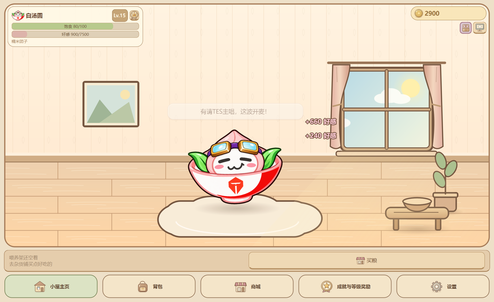
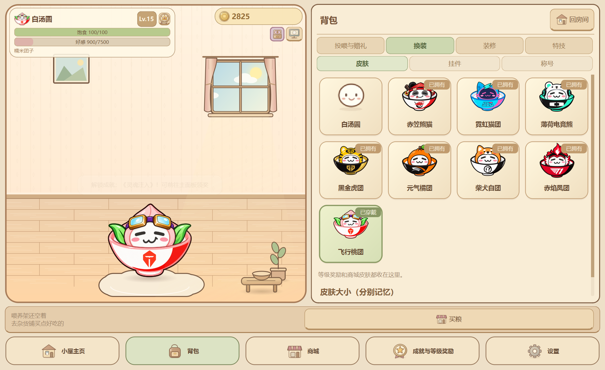

# 礼物清场与皮肤名称修复

2026-10-23，本地源码更新；未更新GitHub或便携EXE。

- 六种礼物（折纸星星、小花束、八音盒、陀螺、吉他、麦克风）都只在各自演出期间绘制。自然结束、被投喂打断或场景停止时，清除临时道具；不再把已送礼物画成地面的常驻小图标。连续赠送仍按队列演出，收益只结算一次。
- 右上角无风味时不显示「原味汤圆」；存在真实风味时仍显示名称与剩余秒数，结束后自动收起。
- 八款内置皮肤在商城、背包换装、等级奖励及升级提示中统一使用纯昵称：赤笠熊猫、霓虹猫团、飞行桃团、柴犬白团、黑金虎团、元气橘团、赤焰凤团、薄荷电竞熊。素材manifest与索引同步改名，PNG像素、碗面队标、皮肤ID、价格、等级、所有权和独立大小/偏移不变。





从托盘退出旧进程后，启动源码：

```powershell
Set-Location -LiteralPath 'D:\Codex\Q弹汤圆'
.\.venv\Scripts\python.exe main.py
```

隔离验收用 `main.py --demo --dev-mode`，不影响正式玩家进度。可在开发设置中预览原四种礼物；测试TES乐器时，在演示档达到Lv.4或开启全部等级特权试用并换上「飞行桃团」，再购买/赠送吉他和麦克风。

1. 分别赠送礼物，等待约7秒；结束后地面没有遗留图标。演出中投喂食品，临时礼物也会清场。
2. 连续赠送两件礼物，等两段演出完成；不残留上一件，余额/背包/好感只按使用次数结算。
3. 没有风味时检查金币槽下方，只有声音与桌宠按钮；投喂黑芝麻糊应显示倒计时，到期后收起。
4. 在「商城 → 战队与装扮」「背包 → 换装 → 皮肤」「成就与等级奖励 → 等级奖励」核对纯昵称；重启确认皮肤选择、所有权和挂件配置不变。

新增 `tests/test_gift_cleanup.py` 覆盖六礼物自然结束/中断/旧标记/过期对象、投喂打断、队列、停止清场、HUD开关及命名/存档/PNG散列。`tests/verify_gift_cleanup_native.py` 使用Windows独立测试档实际消费六种礼物并验证绘制清场与界面，截图已目视复核。截图使用虚拟推进演出时间及实际Qt等待，不冒充连续录屏；音频静音运行，本轮未验证听感或其他电脑。完整测试结果见[开发日志](开发日志.md)。
