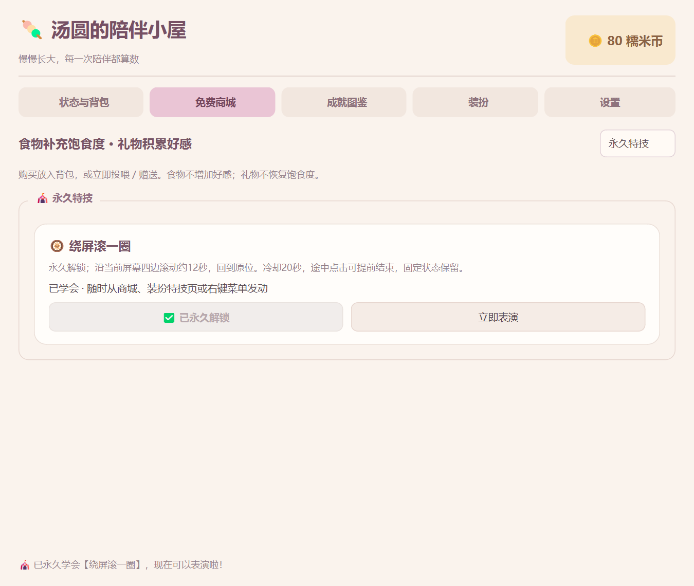

# 商城特技「绕屏滚一圈」验收

重启桌宠后，双击汤圆打开主面板，进入【免费商城】，查看页面底部独立的【永久特技】区域。

1. 花 **120 糯米币** 点击【购买特技】，余额只扣一次，按钮变为“已永久解锁”。初始100币时，可以先完成戳一戳等成就并领奖，或等待在线收益自动入账攒币。
2. 点击【立即表演】。汤圆先靠近当前屏幕边缘，沿工作区四边顺时针滚一整圈，再回出发点，合计约12秒。截图、文字与附带皇冠一起旋转，不会跨到其他显示器。
3. 以后可直接使用【装扮→特技与等级奖励→绕屏滚一圈】或【右键→表演特技】。不占用双击，不反复付币；冷却20秒从发动计起，不额外增加好感EXP。
4. 开启固定位置也可以绕屏，结束后的固定开关、位置及存档锚点不变。滚动途中点击宠物可提前回家，这次点击不计算戳戳收益。冷却继续计时。
5. 试着给本地GIF戴皇冠、吃黑芝麻糊后发动，动画、旋转、1.2倍及挂件应正常。切换皮肤、调整挂件、工作区变化、复位、切换固定或真实饿扁会结束表演并恢复位置。屏幕太小、正在拖拽或空中下落时，先让汤圆站稳再发动。
6. 从托盘安全退出，再双击 D:\虚拟C盘\Q弹汤圆.lnk。购买记录、皮肤、挂件和位置会恢复，无需再次购买。冷却属于当前运行会话，不存入永久进度。

动作以当前屏幕 availableGeometry 为范围，任务栏或系统停靠区域不会算作可滚动区域。为旋转后的身体和挂件留有安全间距，并非让贴图越过屏幕物理边界。

## 验证依据

    Set-Location -LiteralPath 'D:\Codex\Q弹汤圆'
    .\.venv\Scripts\python.exe -B -X utf8 tests\test_phase4_screen_roll.py
    .\.venv\Scripts\python.exe -B -X utf8 tests\verify_screen_roll_native.py

完整310项回归通过，其中23项覆盖本特技的永久购买、余额不足/重复购买拒绝、旧档兼容、冷却与互斥、四边完整路线、负坐标/小屏、提前结束、换装/饥饿/复位中断、默认PNG和动态GIF/皇冠/1.2倍/草莓粒子包围盒、商城及右键控制器链路。24份Python通过3.10语法解析。

Windows单屏150%缩放原生双进程：真实鼠标在商城购买和发动；GIF戴皇冠并叠加芝麻1.2倍，真实运行约12秒采集四边轨迹，回原生窗口起点；第二次从特技页发动并点击取消，戳戳次数不增加；安全退出后另一进程恢复购买/皮肤/挂件/位置，均退出0、stderr空。正式与--demo --dev-mode启动冒烟通过。多实体屏、其他系统及Python3.10运行未实测。

本次测试都使用隔离存档，未给正式玩家档直接赠送此特技。版本5新增可选purchased_tricks，不要求用户重开进度。测试存档、过程截图与轨迹保留在tests/artifacts/，不上传个人素材。

## 本次完整文件清单

- D:\Codex\Q弹汤圆\README.md
- D:\Codex\Q弹汤圆\config\catalog.json
- D:\Codex\Q弹汤圆\dashboard.py
- D:\Codex\Q弹汤圆\docs\images\screen-roll-shop.png
- D:\Codex\Q弹汤圆\docs\开发日志.md
- D:\Codex\Q弹汤圆\docs\目录说明.md
- D:\Codex\Q弹汤圆\docs\绕屏特技验收.md
- D:\Codex\Q弹汤圆\docs\项目规范.md
- D:\Codex\Q弹汤圆\main.py
- D:\Codex\Q弹汤圆\models.py
- D:\Codex\Q弹汤圆\pet_engine.py
- D:\Codex\Q弹汤圆\pet_window.py
- D:\Codex\Q弹汤圆\tests\test_phase4_dashboard.py
- D:\Codex\Q弹汤圆\tests\test_phase4_screen_roll.py
- D:\Codex\Q弹汤圆\tests\verify_screen_roll_native.py

重要配置备份：D:\Codex\Q弹汤圆\config\catalog.json.bak.20261016-222957-467。本次复用现有SaveManager的扩展字段持久化，没有修改save_manager.py或原始图片。
