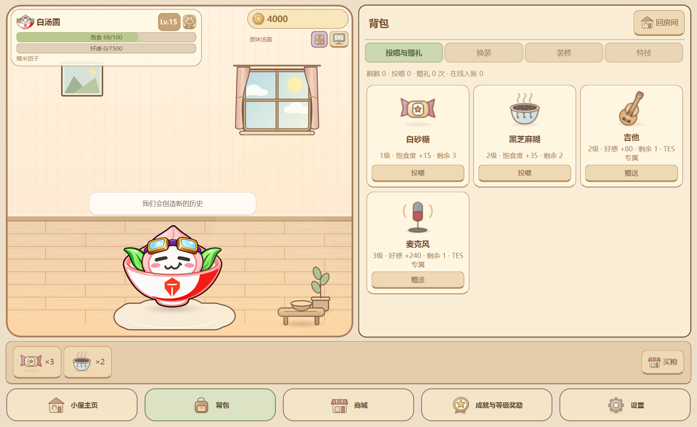
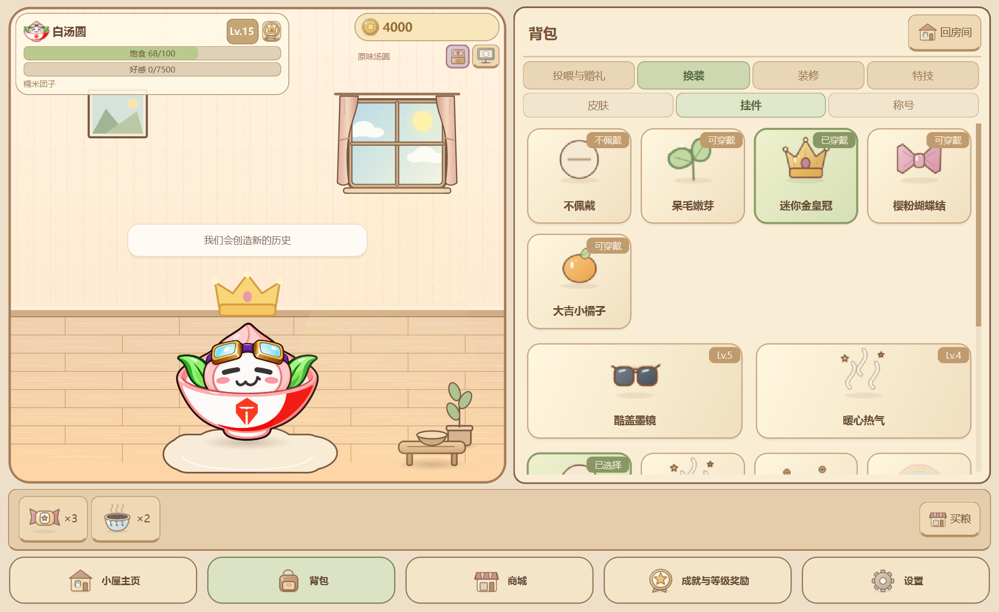
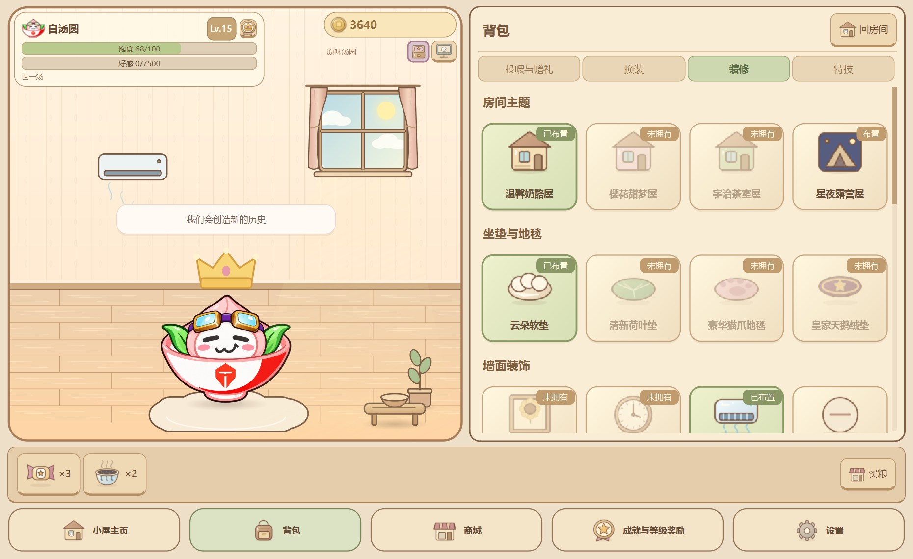
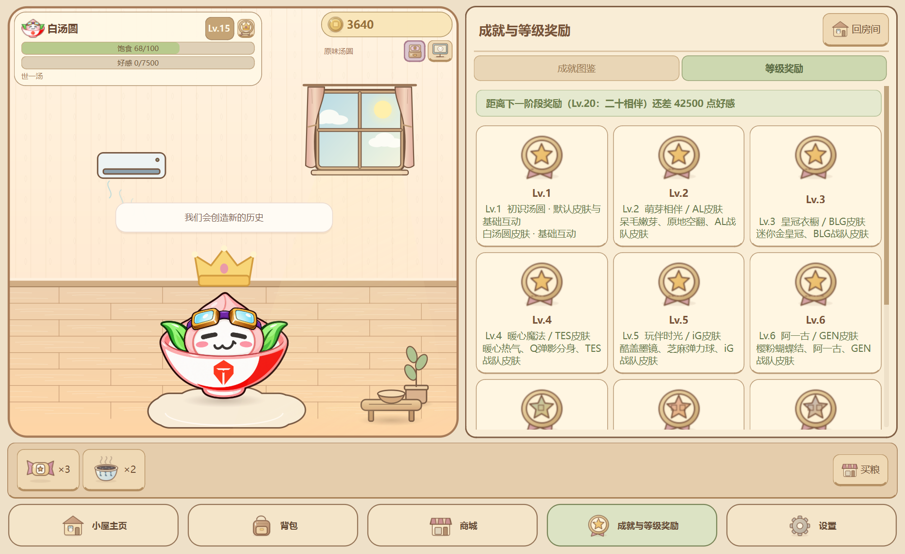

# 背包与成长界面验收

2026-10-23本地开发调整。本轮未更新GitHub、版本号或已发布EXE，等待统一发布2.0。此前1.0及S16验收资料保留当时界面，本地最新导航以本页为准。

## 新导航

```text
小屋主页
背包
├─ 投喂与赠礼
├─ 换装
│  ├─ 皮肤（白汤圆与8款内置战队皮肤）
│  ├─ 挂件
│  └─ 称号
├─ 装修
└─ 特技
商城
成就与等级奖励
├─ 成就图鉴
└─ 等级奖励
设置
```

全部使用主窗口内同屏抽屉。背包内直接投喂、送礼、换装、调挂件高度与装修，房间画面保持可见；底部喂养架和商城快捷使用仍保留。称号统一在「背包 → 换装 → 称号」管理，成就领取后的按钮会带你到该页。





## 移除自定义皮肤入口

不再提供单图PNG/GIF、ZIP、动作文件夹导入、导入预览、白底选项、模板导出、个人皮肤重命名、回收区及50币导入权限入口。等级奖励页和升级播报也不再出现这项系统权限。「灵魂注入」成就的当前说明改为切换战队皮肤或穿戴挂件，原成就ID和已领奖状态保留。

衣橱只展示默认皮肤和正式内置战队皮肤；通过等级获得或商城购买后换上，原有独立大小与挂件高度记忆保留。旧版私人图片、皮肤配置与进度没有物理删除；保留旧档/旧备份读取服务，避免升级丢失已有数据。若旧档已选私人外观，仍可兼容读取，但不再出现在衣橱选择或管理列表；换上内置皮肤后不能从界面重新选回私人外观。

## 空调与成长

商城和背包装修中名称统一为「空调」，开机对白也使用该名称。ID `air_conditioner`、价格360币、墙面槽位与开关状态不变，不需要重新购买。



「成就与等级奖励」集中展示三阶成就、领奖与Lv.1～30里程碑。原始进度、币、称号、家具和皮肤所有权不变。下一阶段经验提示仍在等级奖励页及HUD悬停提示中。



## 本地操作验收

从托盘退出旧进程后，在PowerShell执行：

```powershell
Set-Location -LiteralPath 'D:\Codex\Q弹汤圆'
.\.venv\Scripts\python.exe main.py
```

隔离验收档：

```powershell
.\.venv\Scripts\python.exe main.py --demo --dev-mode
```

1. 检查五个底部入口是「小屋主页、背包、商城、成就与等级奖励、设置」。依次打开，房间应始终可见。
2. 在商城买食品与礼物，进入背包使用；确认扣库存、实际收益飘字和专属演出正常，投喂食物不加好感。
3. 背包换装页切换内置皮肤、佩戴皇冠、调高度、选择称号，直接在房间看效果；确认没有任何导入或个人皮肤管理控件。
4. 商城买空调，进入「背包 → 装修」布置，点击房间空调开关。退出重启确认家具、开关、皮肤、挂件与称号保留。
5. 打开「成就与等级奖励」，在图鉴和奖励两个子页切换。成就奖励只能领取一次；称号按钮前往背包换装，设置通过底部独立入口进入。

## 自动验证

```powershell
$env:QT_QPA_PLATFORM='offscreen'
.\.venv\Scripts\python.exe -B -X utf8 -m unittest discover -s tests -p 'test_*.py' -v
```

新增 `tests/test_inventory_navigation.py` 覆盖分类归属、同屏显示、旧内部导航路由、导入入口与奖励文案缺席、旧素材/选择保留、背包投喂赠礼/穿戴、空调命名与持久化、升级不播报移除权限、成就单次领奖和称号跳转。旧界面测试按当前需求更新；底层PNG/GIF/ZIP校验与旧备份兼容测试保留。

`tests/verify_inventory_native.py` 使用独立Windows测试档检查真实控件操作与保存，并导出四张截图；截图已目视复核。该脚本为留证工具，已有同名正式截图时会停止以免覆盖；本轮执行记录与完整测试结果见[开发日志](开发日志.md)。未构建新EXE，未验证其他电脑或本轮音效听感。
